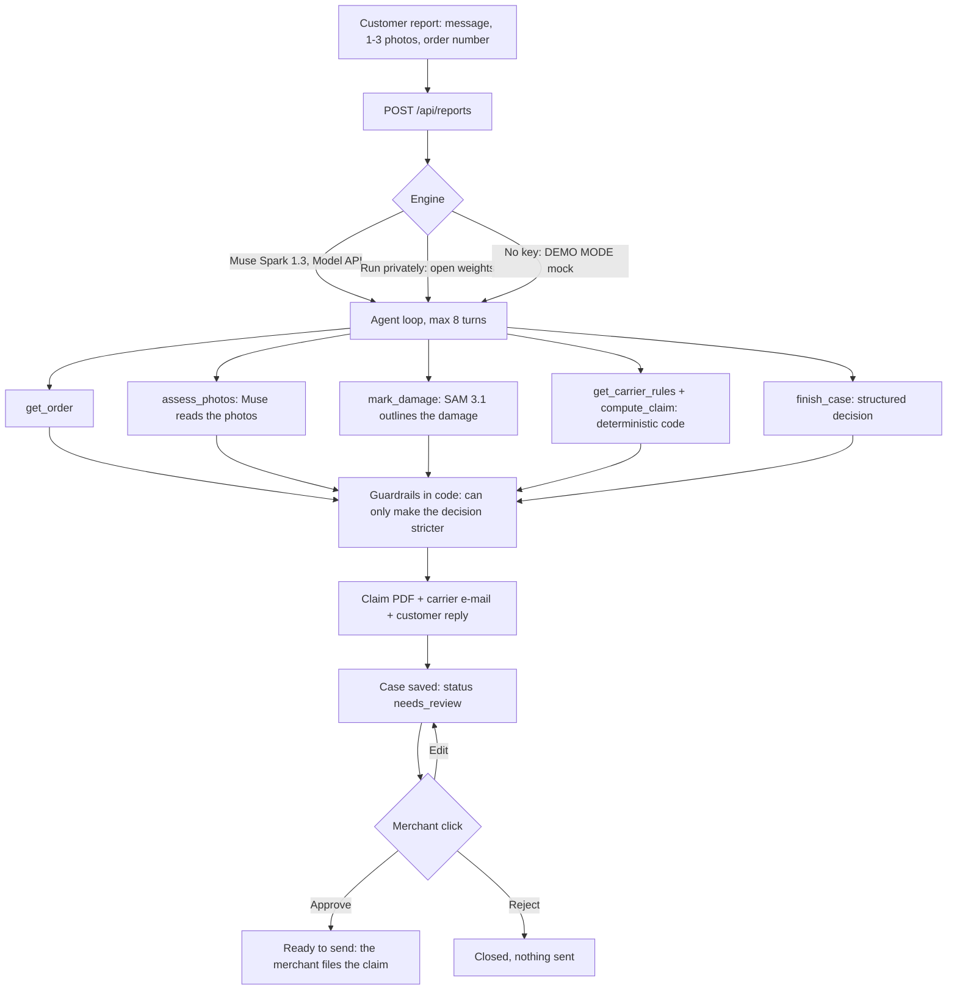

# Damage Desk

**The agent that recovers the money from damaged parcels.**

A customer writes "my vase arrived broken" and attaches a photo. Damage Desk finds the order,
reads the photo, decides what to do (reship, refund, ask for a better photo, or nothing), builds
the carrier claim as a PDF plus a ready-to-send e-mail, and drafts the reply in the customer's
language. The merchant reviews the case and clicks **Approve**, **Edit** or **Reject**.

Nothing is sent without a click, and this app sends nothing at all: the claim and the reply are
drafts that the merchant files or sends.

Built for the Meta Global AI Developer Hackathon, Startups track, theme "Build for Your World".

> **Built during the Meta Global AI Developer Hackathon (Oct 27 – Nov 4, 2026). Prior work: none —
> all code written during the hackathon; domain knowledge from running an e-commerce store's
> customer support.**
>
> All orders, customers and e-mail addresses in this repository are fictitious.

## The problem

When a parcel arrives broken, a small merchant does two jobs by hand: make the customer whole
(a replacement or a refund), then chase the carrier for compensation. The second job is where the
money leaks, because each carrier has its own channel, its own proof, its own cap and, above all,
its own **deadline**, and some of them are short:

| Carrier (standard professional terms) | Compensation | Deadline to claim | Status of the figures |
|---|---|---|---|
| **Colissimo** | 23 EUR/kg, capped at 690 EUR per parcel (33 EUR/kg, 990 EUR with signature) | 12 months (France) | **Dated source**: 2020-12-08 edition of the [general terms](https://www.colissimo.entreprise.laposte.fr/sites/default/files/2021-03/cgv-contrat-facilite.pdf). The 2026 terms are not public, so the current figures are not confirmed. |
| **Colissimo** (3-day reserve window) | n/a | 72 h applied out of prudence | **Unverified**: Commercial Code [art. L133-3](https://www.legifrance.gouv.fr/codes/article_lc/LEGIARTI000021486442) was read, but we found no text saying it applies to Colissimo. It only adds a warning, it never blocks a claim. |
| **Mondial Relay** (Offre Start) | 25 EUR per parcel, shipping not refunded | 72 h after delivery, and the parcel must be **refused** at delivery | **Verified** against the [terms of 2025-09-01](https://www.mondialrelay.fr/media/125872/20250901-france-offre-start-conditions-g%C3%A9n%C3%A9rales-de-vente-fr.pdf) and the [recipient FAQ](https://www.mondialrelay.fr/faq/recevoir-un-colis/mon-colis-est-abime-que-faire/). Lockers are not modelled. |
| **Chronopost** (professional terms) | 250 EUR per parcel by default; 23 EUR/kg capped at 690 EUR for Chrono 18, Chrono Classic, Chrono Relais Europe and mobile-phone items | 3 days after delivery | **Verified** against the [online terms](https://www.chronopost.fr/fr/conditions-generales-de-vente-professionnels), which show no edition date. The "mobile phone" rule is a keyword heuristic of ours. |

Every figure above, with its source URL, check date and status, lives in
[`data/carriers.json`](data/carriers.json) and is shown in the app next to the claim.

Caveats that matter:

- These are the **public standard terms**. A merchant with a negotiated contract may have other
  caps and deadlines, which are not public: treat the figures as unverified for those merchants.
- The merchant usually owes the customer first. As we read French consumer law (Code de la
  consommation art. L216-2, not legal advice), the risk stays with the seller until the consumer
  physically takes the goods. So the agent serves the customer, then claims the carrier. A late
  claim does not change what the customer is owed.
- We found no public claim API at any of the three carriers (a search, not a proof). Claims are
  filed by a human through each carrier's tool or by e-mail, which is why the output is a
  complete dossier that the merchant files.

## How it works

1. **Report.** A customer message, one to three photos and an order number arrive (in the demo, a
   form that stands in for the inbox).
2. **Investigation.** An agent calls tools in a loop: it fetches the order, reads the photos,
   outlines the damage, looks up the carrier's rules and computes the claim.
3. **Decision.** A structured answer: `reship | refund | ask_more_photos | no_action`, whether to
   claim the carrier, a confidence, reasons, and whether a human must look.
4. **Drafts.** A claim PDF, an e-mail to the carrier's claims department, and a reply to the customer.
5. **Review.** The merchant opens the case, reads the agent's reasoning trace, and approves, edits
   or rejects. The header counter shows the recoverable amount and the claims due this week.



**Amounts and deadlines never come from the model.** They come from the dated, sourced carrier
rules and from deterministic code in `src/lib/rules`. The model can only choose which tool to call
and what to conclude from what the tools return.

**Guardrails run in code after the model answers and can only make a decision stricter.** A human
is required when the confidence is below 0.7, the order is above 300 EUR, the order match is
doubtful, there are fraud signals, the photos are too blurry, a tool failed, or the customer reply
quotes a figure the tools did not return. Customer text is treated as untrusted data; a
prompt-injection attempt counts as a fraud signal.

## Which Meta models, and why

| Step | Model | Why this one |
|---|---|---|
| Investigation | **Muse Spark 1.3** (Meta Model API, Standard mode, `muse-spark-1.3`) | One model does three jobs in the same loop: **vision** (it reads the photos), **tool calling** (order lookup, damage marking, rules, claim maths) and a **structured decision** returned through the `finish_case` tool call and validated in code. |
| Evidence | **SAM 3.1** (Meta Model API) | A claim needs proof, not only a verdict. Muse names what to outline (for example "shattered vase" or "torn cardboard flap"), SAM segments it, and the annotated photo goes into the claim PDF. If SAM finds nothing or fails, the claim ships with the raw photo and says so. |
| "Run privately" | **Muse Glimmer** (open weights, Apache 2.0, served with vLLM on Modal, see [`deploy/`](deploy/README.md)) or **Muse Spark Open** through a provider | Parcel photos and customer messages can stay on infrastructure the merchant controls. The same agent, tools and output schema run on open weights. A private run never calls the Model API, SAM included. |

The product is the decision and the dossier, not an image analyzer: the photo is one input among
several, and the output is money-shaped (a decision, a maximum compensation, a deadline, a
filled-in claim).

Standard mode only: a model id containing `contributor` (Meta trains on that traffic) is refused in
code (`assertStandardModel`), and a test scans the repository for such ids.

## Architecture

A single Next.js (TypeScript) app, no database: cases are JSON files, claim PDFs are built with
`pdf-lib`.

- `src/lib/agent/`: the loop (`run-agent.ts`, at most 8 model turns), the tool schemas
  (`tools.ts`), the system prompt, and the guardrails (`guardrails.ts`).
- `src/lib/providers/`: an OpenAI-compatible client for Muse Spark 1.3 and for open weights, and
  the deterministic demo mock.
- `src/lib/rules/` and `data/carriers.json`: carrier rules and the claim maths (maximum
  compensation, deadline, warnings).
- `src/lib/evidence/`: the SAM 3.1 call and the annotation of the photo.
- `src/lib/documents/`: the claim PDF and the e-mail to the carrier.
- `src/lib/orders/`: fictitious orders (`data/fixtures/orders.json`) and an optional read-only
  Shopify connection (`read_orders` only).
- `src/lib/store/`: case files, the header counter, the demo cases.
- `src/app/`, `src/components/`: the UI (Cases list, new report, case review) and the API routes.
- `deploy/`: Muse Glimmer on Modal.

## Run it locally

```bash
npm install
cp .env.example .env.local    # optional; leave MODEL_API_KEY empty for demo mode
npm run demo                  # the six demo cases end to end: no key, no network
npm run dev:demo              # the web app in demo mode, never spends credits
```

Environment variables (all listed, empty, in [`.env.example`](.env.example)):

| Variable | Purpose |
|---|---|
| `MODEL_API_KEY` | Meta Model API key. Empty means **demo mode**. |
| `MODEL_BASE_URL` | Defaults to `https://api.meta.ai/v1`. |
| `MODEL_REASONING_EFFORT` | Optional reasoning effort for Muse Spark. |
| `OPEN_WEIGHTS_BASE_URL`, `OPEN_WEIGHTS_MODEL`, `OPEN_WEIGHTS_API_KEY`, `OPEN_WEIGHTS_PROXY_KEY`, `OPEN_WEIGHTS_PROXY_SECRET`, `OPEN_WEIGHTS_REASONING_STRENGTH` | The "Run privately" engine (Glimmer on Modal, or Muse Spark Open). |
| `SAM_BASE_URL` | SAM 3.1 endpoint if different from `MODEL_BASE_URL`. |
| `SHOPIFY_SHOP_DOMAIN`, `SHOPIFY_ADMIN_ACCESS_TOKEN` | Optional read-only dev store. Empty means fictitious orders. |
| `MERCHANT_NAME`, `MERCHANT_ADDRESS`, `MERCHANT_EMAIL` | Merchant identity printed on the claim. |
| `DAMAGE_DESK_ACCESS_CODE`, `DAMAGE_DESK_REAL_RUNS_PER_DAY` | For a public deployment: a shared code for real engines and for approve/edit/reject, and a daily cap of real runs. |

**Demo mode.** Without `MODEL_API_KEY` the app uses a deterministic mock provider and labels every
result "DEMO MODE": the case, the trace, the badge, the PDF footer and the logs. The mock follows a
script keyed on the customer's words and on what the tools return, and never looks at an image.
A mock answer is never presented as coming from Muse.

**Real mode.** Set `MODEL_API_KEY`. Careful: Next.js loads `.env.local`, so a key there makes a
plain `npm run dev` call the real, paid models and send the photos to Meta. `npm run dev:demo`
empties the variables for that process.

**Open weights.** Follow [`deploy/README.md`](deploy/README.md) to serve Muse Glimmer on Modal, set
the `OPEN_WEIGHTS_*` variables, then pick "Run privately" on the new-report screen.

Checks: `npx vitest run`, `npx tsc --noEmit`, `npm run lint`. Tests use no network and no key, and
write to a throwaway folder, never to `data/runtime/`.

## The six demo cases

`npm run demo` runs them through the agent in demo mode and stores them so the Cases screen shows
them. On the new-report screen each one is a single click. The "Expected" column is what the
scripted demo mode produces, and what `data/demo-cases.json` checks; it is not a measured result of
Muse.

| # | Story | Expected |
|---|---|---|
| 1 | Broken vase, Colissimo, order #1001 | Reship, claim the carrier. Maximum 52.90 EUR (23 EUR/kg x 2.3 kg, under the 58 EUR item value). |
| 2 | Crushed carton, product intact, #1002 | No action, no claim: nothing to compensate. |
| 3 | Blurry lamp photo, #1003 | Ask for sharper photos before deciding anything. |
| 4 | Parcel opened at the relay, saucers missing, Mondial Relay, #1004, customer writes in French | Reship, claim within the 72 h window (25 EUR maximum), reply in French. |
| 5 | Cracked headphones, 349 EUR, #1005 | Everything prepared (250 EUR maximum under the Chronopost default), but handed to a human because the value is above 300 EUR. |
| 6 | Cracked carafe reported nine days after delivery, #1006 | Refund the customer; no carrier claim, the 3-day window has passed. |

> **About the demo photos.** The images in `data/photos/` are currently **provisional
> AI-generated stand-ins**, not photographs taken by the team (see
> [`data/photos/README.md`](data/photos/README.md)). Dropping `<name>.jpg` next to a stand-in
> replaces it. It is not confirmed that a vision model reads a synthetic image the way it reads a
> real photo.

## Limitations

- **Not verified against the live Meta APIs.** No call to the Model API, SAM or Glimmer has been
  made from this code. Request shapes follow Meta's public documentation and are tested against
  fakes. Whether the live endpoints accept the tools, images and multi-turn loop exactly as sent
  is still to be confirmed with a key.
- **Demo mode is scripted.** It shows the product flow, not the quality of Muse's reading of a photo.
- **Carrier figures are the public standard terms**, some from a dated source and one window
  unverified (table above). Not modelled: insurance (ad valorem), negotiated contracts, relay
  lockers, public holidays, the carrier-measured weight.
- Colissimo pays on the purchase value of the content; the order only carries the sale price, so the
  computed maximum may be higher than the real indemnity.
- **Nothing is filed.** The app files no claim and sends no e-mail; a human does.
- **Not legal advice.** The rules are our reading of public terms and statutes.
- **Public deployment is not done.** On Vercel, storage is temporary and per instance, so a case can
  answer 404 on another instance; rate limits are in memory. Do not put real customer data on a
  public URL: the case list is open. `next@16.4.0` has open security advisories (16.4.1 passes the
  project's 14-day dependency rule on 2026-10-28), so upgrade before exposing it.
- The open-weights deploy script has only been syntax-checked; `deploy/README.md` lists what to
  verify first.

## Third-party licences

This repository's own code is MIT-licensed (see [`LICENSE`](LICENSE)). It depends on packages under
their own licences:

- **`@meta-sam/parser`**, which decodes SAM 3.1 masks, is **not MIT**: it is under Meta's SAM
  License (`node_modules/@meta-sam/parser/LICENSE`). It is installed as a dependency, not
  redistributed or modified here.
- Muse Glimmer (`meta-models/Muse-Glimmer-30B`) is Apache 2.0.
- `next`, `react` and `pdf-lib` are MIT; `openai` and `sharp` are Apache 2.0. Run `npm ls` for the
  full tree.

## License

MIT. Copyright (c) 2026 Pablo Priefert.
