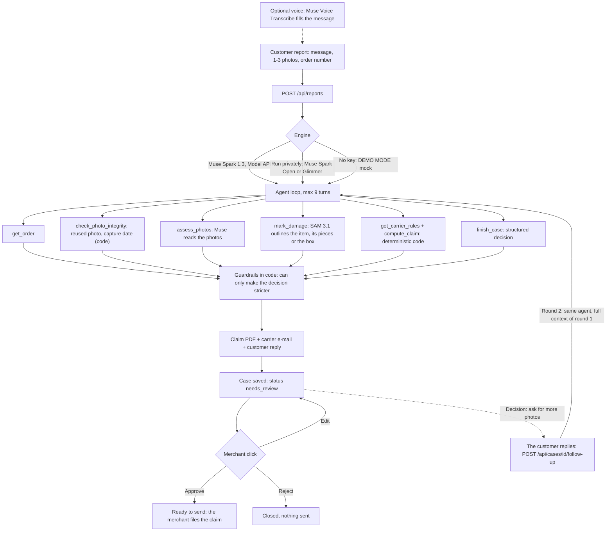

<p align="center">
  
</p>

# Gilmend

**Broken parcels, mended in gold.**

The agent that prepares the claim to recover the money from damaged parcels.

> **Why Gilmend.** Gilmend is *gild* + *mend*. In kintsugi, a broken vase is mended with gold: the
> crack is not hidden, it is kept and made valuable. A damaged parcel is the same kind of break.
> The agent turns it into a claim, so the damage becomes money recovered. The logo is a dark tile
> (the parcel seen from above) crossed by a gold seam. The project was started under the working
> name Damage Desk; the repository and the live URL below still carry it for now.

A customer writes "my vase arrived broken" and attaches a photo. Gilmend finds the order,
reads the photo, decides what to do (reship, refund, ask for a better photo, or nothing), builds
the carrier claim as a PDF plus a ready-to-send e-mail, and drafts the reply in the customer's
language. The merchant reviews the case and clicks **Approve**, **Edit** or **Reject**.

Nothing is sent without a click, and this app sends nothing at all: the claim and the reply are
drafts that the merchant files or sends.

**Live demo: https://gilmend.vercel.app** (the six recorded runs are open to everyone;
filing a new report needs the access code given in the hackathon submission).

Built for the Meta Global AI Developer Hackathon, Startups track, theme "Build for Your World".

> **Built during the Meta Global AI Developer Hackathon (Oct 26 – Nov 4, 2026). Prior work: none —
> all code written during the hackathon; domain knowledge from running an e-commerce store's
> customer support.**
>
> All orders, customers and e-mail addresses in this repository are fictitious.

## What was built during the hackathon

Everything: this is a new repository, and the commit history starts on 27 Oct 2026. In order:

- **The agent**: a tool-calling loop on Muse Spark 1.3 (8 tools, at most 9 turns), a structured
  decision, and guardrails in code that can only make it stricter.
- **Evidence integrity**: `check_photo_integrity` hashes every photo, compares it with the photos of
  the other stored cases and the demo photos, and compares its EXIF capture date with the delivery
  date. A signal sends the case to a human; nothing is rejected on its own
  ([Evidence integrity](#evidence-integrity)).
- **Deterministic carrier rules and claim maths** from dated, sourced public terms, so the model
  never writes an amount or a deadline.
- **Evidence**: SAM 3.1 outlines what the agent names (the broken item, its pieces or the box:
  it finds things, not damage) and the annotated photo goes into the claim. If the model skips
  that step, the code asks SAM once and the trace says so.
- **The dossier**: a claim PDF and an e-mail to the carrier in English, and a reply in the
  customer's language. Nothing is sent: the merchant clicks Approve, Edit or Reject.
- **Voice reports**: the customer can dictate the report (Muse Voice Transcribe).
- **A "Run privately" engine** on open weights (Muse Spark Open on Baseten, or Muse Glimmer on
  Modal), and a clearly labelled OpenRouter test engine.
- **Six recorded real runs** (Muse Spark 1.3 + SAM 3.1) committed as a read-only showcase, and a
  shared-storage backend (Vercel Blob) for a public deployment.
- **Impact views**: an Insights band on the Cases page (money per carrier, the deadlines of the
  next 14 days, the decisions) and an `/impact` calculator that runs the app's own claim rules on
  the merchant's figures ([Impact](#impact)).
- **A follow-up loop** (28 Oct 2026): a case that ends in "ask for sharper photos" is not a dead
  end. The merchant adds the customer's reply to the same case and the agent resumes with the full
  context of round 1 (see [The follow-up loop](#the-follow-up-loop)).
- **Seven demo photos generated with Muse Image** (the six cases, plus the sharp lamp of the
  follow-up demo), declared as AI-generated.

### How it was built

Built solo by Pablo Priefert during the hackathon, with AI coding agents (Claude Code) doing much
of the implementation under his direction. Every claim about a live run in this README comes from
a real run that was checked, not from the code alone. The early commits are squashed into a few
large ones, so the history is coarser than the work was.

What has been run live, and what has not (details in [Limitations](#limitations)):

| Live on the real service | Written and tested, not run live yet |
|---|---|
| Muse Spark 1.3 and SAM 3.1: all six demo cases end to end, 27 Oct 2026 | Muse Spark Open on Baseten and Muse Glimmer on Modal ("Run privately") |
| A follow-up round on the recorded blurry lamp: one real run of `npm run real:follow-up` (Muse Spark 1.3 + SAM 3.1), 27 Oct 2026, [numbers below](#a-real-follow-up-round-27-oct-2026) | The follow-up route and page on the deployed URL (Vercel, Blob): exercised only locally, over the real route handlers in demo mode |
| Muse Voice Transcribe: real API calls (not yet with a browser microphone) | |
| Muse Image: the seven demo photos | |
| Public deployment on Vercel with a private Blob store: a real report filed on the deployed URL on 27 Oct 2026 (Muse Spark 1.3 + SAM 3.1, 54 s), its case, annotated photo and PDF read back on several requests | |
| OpenRouter test engine: one real photo call | |

1008 tests, `tsc` and `eslint` pass. `next build` last passed before the follow-up loop (28 Oct 2026): the loop was written in a worktree where `next dev` and `next build` cannot run, so its page was only looked at through a local harness (the real route handlers and components, without Next), not through Next itself.

## The problem

When a parcel arrives broken, a small merchant does two jobs by hand: make the customer whole
(a replacement or a refund), then chase the carrier for compensation. The second job is where the
money leaks, because each carrier has its own channel, its own proof, its own cap and, above all,
its own **deadline**, and some of them are short:

| Carrier (standard professional terms) | Compensation | Deadline to claim | Status of the figures |
|---|---|---|---|
| **Colissimo** | 23 EUR/kg, capped at 690 EUR per parcel (33 EUR/kg, 990 EUR with signature) | 12 months (France) | **Dated source**: 2020-12-08 edition of the [general terms](https://www.colissimo.entreprise.laposte.fr/sites/default/files/2021-03/cgv-contrat-facilite.pdf). The 2026 terms are not public, so the current figures are not confirmed. |
| **Colissimo** (3-day reserve window) | n/a | 72 h applied out of prudence | **Unverified**: Commercial Code [art. L133-3](https://www.legifrance.gouv.fr/codes/article_lc/LEGIARTI000021486442) was read, but we found no text saying it applies to Colissimo. It only adds a warning, it never blocks a claim. |
| **Mondial Relay** (Offre Start) | 25 EUR per parcel, shipping not refunded | 72 h after delivery, and the parcel must be **refused** at delivery | **Verified** against the [terms of 2025-09-01](https://www.mondialrelay.fr/media/125872/20250901-france-offre-start-conditions-g%C3%A9n%C3%A9rales-de-vente-fr.pdf) and the [recipient FAQ](https://www.mondialrelay.fr/faq/recevoir-un-colis/mon-colis-est-abime-que-faire/). Lockers are not modelled. |
| **Chronopost** (professional terms) | 250 EUR per parcel by default; 23 EUR/kg capped at 690 EUR for Chrono 18, Chrono Classic, Chrono Relais Europe and mobile-phone items | 3 days after delivery | **Verified** against the [online terms](https://www.chronopost.fr/fr/conditions-generales-de-vente-professionnels), which show no edition date. The "mobile phone" rule is a keyword heuristic of ours. |

Every figure above, with its source URL, check date and status, lives in
[`data/carriers.json`](data/carriers.json) and is shown in the app next to the claim.

Caveats that matter:

- These are the **public standard terms**. A merchant with a negotiated contract may have other
  caps and deadlines, which are not public: treat the figures as unverified for those merchants.
- The merchant usually owes the customer first. As we read French consumer law (Code de la
  consommation art. L216-2, not legal advice), the risk stays with the seller until the consumer
  physically takes the goods. So the agent serves the customer, then claims the carrier. A late
  claim does not change what the customer is owed.
- We found no public claim API at any of the three carriers (a search, not a proof). Claims are
  filed by a human through each carrier's tool or by e-mail, which is why the output is a
  complete dossier that the merchant files.

## How it works

1. **Report.** A customer message (typed or dictated), one to three photos and an order number
   arrive (in the demo, a form that stands in for the inbox).
2. **Investigation.** An agent calls tools in a loop: it fetches the order, checks the photos for
   reuse and capture date (code), reads the photos, has SAM outline the item or the box, looks up
   the carrier's rules and computes the claim.
3. **Decision.** A structured answer: `reship | refund | ask_more_photos | no_action`, whether to
   claim the carrier, a confidence, reasons, and whether a human must look.
4. **Drafts.** A claim PDF, an e-mail to the carrier's claims department, and a reply to the customer.
5. **Review.** The merchant opens the case, reads the agent's reasoning trace, and approves, edits
   or rejects. The header counter shows the recoverable amount and the claims due this week.
6. **Follow-up (if the agent asked for more).** The customer replies with sharper photos or the
   right order number, the merchant adds the reply to the case, and the agent runs again on the same
   case: round 2, with the full context of round 1 ([details](#the-follow-up-loop)).



### Live run

The report page shows the investigation as it happens, not an illustration of it. `runAgent` takes
an `onEvent` callback and emits a structured event at the line of code that does each thing: the
run starts (engine, model), a model turn starts and ends ("Muse is reading the report and the
photos", never its reasoning text), each tool starts and ends with what it found (the order, the
reading, the SAM outline with its region count and the stored image path, the carrier, the claim
amount and deadline, the decision), each guardrail that changes the decision, and every notice
(photos not read, run ended without a decision). `POST /api/reports` streams them as NDJSON when
the client sends `Accept: application/x-ndjson` (or `?stream=1`): `accepted`, the agent's events,
then `done` with the case id (or `error`). Without that header the route answers the same JSON as
before, and every gate (access code, rate limit, daily cap, validation, storage) runs before the
first line is sent. The case is saved exactly as in the JSON answer, before `done`. If the browser
leaves, the run still finishes and is saved (the route registers it with `after()` so a serverless
function is not frozen when the response ends; tested by cancelling the reader, not on Vercel).

On the page, each step appears with the server's own clock (`+4.2 s`, and how long it took), the
order card, the SAM image fading in once it is stored, the claim amount rolling up in gold (the
number is the code's), and guardrail warnings; when the case is saved, "Open the case" (it also
opens by itself after 5 s unless you stay). A DEMO MODE run streams the same real steps (the order
lookup, the claim maths and the PDF are code) but is labelled "DEMO MODE (scripted)", shows no
timings (not even a header clock) and never shows an outline. If nothing streams within 10 s (a proxy
that buffers, an older server), the page falls back to the old step list, labelled as an illustration.

The first model turn says what the model was really given: `run_started` carries `photosSent` (how many
photos were attached to the opening message), and a `photos_withheld` notice (a text-only model, or a
server that answered HTTP 400/413/415/422 to the images and was retried without them) brings it to 0, so the
row reads "the report (photos not shown to it)" instead of "the report and the photos". Guardrail rows are
worded in plain English; the raw wording stays in the case's trace. If the connection drops after the report
was stored, the timeline stays with a link to the case and tells the person not to send the report again:
the run should finish on the server (see the `after()` caveat above, not verified on Vercel). "File another
report" clears the form once a run is over.

The photo integrity check is a row of the timeline like the others (merge of 28 Oct 2026): "Checking the
photos for reuse and capture date", with counts only (photos compared, earlier cases and demo photos they
were compared with, how many signals and of which kind), "no signal" worded as not proving the photos genuine,
and "Run by the code, not the model" when the loop ran it because the model had not. A signal reaches the
guardrail row as a plain sentence ("the photo check found 1 thing to look at (a photo already filed in another
case), a reason to look and not a verdict"). Never a hash, a case id or the text of a signal: they describe other
customers' cases. `resumeAgent` shares the loop and the `onEvent` option, so a follow-up run emits the same
events (the check then counts every photo of the case); no route streams them yet, since `POST
/api/cases/[id]/follow-up` answers plain JSON and the follow-up panel has no live timeline.

Events never carry the API key, a photo's bytes (a data URL is dropped, only a stored path is
kept), the customer's name, e-mail, address or message, the reply, or the model's free text:
errors and model-written strings go through `scrub` (`src/lib/agent/events.ts`) first, and a test
checks a full run's events for all of these.

Measured on 27 Oct 2026 by calling the route handler in-process with the real key (demo case 1,
Muse Spark 1.3 and SAM 3.1): 34 events over 27 s, the first line sent 9 ms after the request, each
event read 8 to 10 ms after the server stamped it, the SAM image stored (2 regions) at +12.9 s. That
is not a measurement over the deployed Vercel URL, whose buffering and latency were not tested. It predates
the integrity tool: a run now has two more events (the check starts and ends).

**Amounts and deadlines never come from the model.** They come from the dated, sourced carrier
rules and from deterministic code in `src/lib/rules`. The model can only choose which tool to call
and what to conclude from what the tools return.

**Guardrails run in code after the model answers and can only make a decision stricter.** A human
is required when the confidence is below 0.7, the order is above 300 EUR, the order match is
doubtful, there are fraud signals, the photo integrity check found a signal (a photo reused for
another order, a capture date before the delivery), the photos are too blurry, a tool failed, the customer reply
quotes a figure the tools did not return, or Muse read the packaging as inadequate on a claim that
is kept (the claim is not cancelled on that reading: it stays, with a merchant-only warning to check
the packing before filing, and the carrier file says nothing about it: neither the reading nor the
model's notes about the packing). Customer text is treated as untrusted data; a
prompt-injection attempt counts as a fraud signal.

## Impact

Two views turn the cases into money and time. Neither invents a number: each one is computed from
stored cases, from the carrier rules, from the recorded runs, or from an input the merchant can see
and change.

**Insights** (Cases page, under the header band), computed by `src/lib/impact/insights.ts`:

- *Money still claimable, by carrier*: the maximum compensation of every claim still open (any
  month: the counter above counts this month only), per carrier, with the carrier's window (3 days
  after delivery for Mondial Relay and Chronopost, the ones that expire unnoticed; 365 days after
  shipment for Colissimo, counted from the order date, the safe side).
- *Deadlines in the next 14 days*: one strip per carrier, plus a list with the same events as text,
  soonest first. Day 0 is "Now" for live cases and "Recording" when only recorded runs are drawn;
  a recorded run is never painted urgent, since its distance counts from its recording day. It
  shows the claim deadline and, when it closes at another moment, the reserve window (Colissimo's 72 h window only warns and is marked "prudential").
- *What the agent decided*: reship, refund, ask for photos, no action, and how many cases were
  handed to a human.
- Recorded runs are left out of these numbers, like in the header counter, unless the **Include
  recorded runs** switch is on (it starts on only when there is no live case, so a fresh deployment
  is not three empty charts). When counted they are read **as of their recording day**: their
  deadlines run from 27 Oct 2026, not from today. The band above keeps its live-only counters.

**`/impact`** (header link "Impact"), computed by `src/lib/impact/roi.ts`: enter orders per month,
damage rate, the value of a damaged item, its weight and the carrier mix. It returns damaged
parcels a year, the value of the damaged goods, the carrier compensation within reach, what a claim
filed late by hand loses against one filed with Gilmend, and the time per case.

| What | Where it comes from |
|---|---|
| Carrier amounts and deadlines | The app's own `computeClaim` and `data/carriers.json`, run on a synthetic order built from your inputs. The result is a ceiling, like every amount in the app, not a promise of payment. |
| Agent time per case | **Measured** on the six recorded runs (first to last step of each trace): 27 s on average, from 16 s to 35 s; five of the six drew a SAM 3.1 outline (the blurry-photo run stops at "ask for better photos" and calls no SAM), and the page counts them. Six scripted scenarios with generated photos, one run each: a measure, not a benchmark. |
| Damage rate, share of damaged parcels that qualify, share of Mondial Relay parcels refused at delivery (it pays nothing for an accepted one; we know of no rate, the default is 20%), when the customer writes in, when a claim is filed by hand and with Gilmend, minutes per case by hand, your review time | **Assumptions**, labelled as such next to each field, with a default that is an example and not a statistic. |
| Orders, item value, weight, carrier mix | Your figures (the defaults are examples). |

What the public record says is on the page and not used as an input: a DS Smith and Opinium survey
published on 7 Jan 2026 (2,000 French consumers, collected in October 2025) found that 22% of them
received a damaged product in the previous 12 months and puts the average cost at 76.50 EUR per
damaged article. It counts consumers who had a problem, not damaged parcels per 100 shipped, and
it was commissioned by a packaging supplier, so the calculator derives no damage rate from it
([Ecommerce Magazine](https://www.ecommercemag.fr/logistique-1222/barometre-etude-2182/les-colis-endommages-coutent-23-milliards-deuros-par-an-aux-e-commercants-francais-55038),
[LSA](https://www.lsa-conso.fr/e-commerce-les-colis-endommages-coutent-2-3-milliards-d-euros-aux-marchands-francais-selon-une-etude,463876/);
read on 27 Oct 2026). We found no sourced per-parcel damage rate to cite, so the default 2% is an
example.

## Evidence integrity

A claim is only as good as its photos, so the agent checks the evidence before it believes it.
`check_photo_integrity` is plain code, not a model call, and it runs in demo mode too (only the
model's reading of the photos is scripted there). The model sees its result as a tool result; the
guardrails act on it; the case keeps it and the case page shows it in an **Integrity** row under
the photos.

- **Same photo, another order.** Every photo gets two 64-bit perceptual hashes (dHash and aHash,
  computed with `sharp` after the EXIF rotation, `src/lib/integrity/image-hash.ts`). They are stored
  on the case, and each new report is compared with the hashes of the 200 most recent stored cases
  (the result says when older ones were left out), so it works across serverless instances and
  storage backends. A match with a case of another order **or** another customer is a signal; the
  same customer filing the same photo again for the same order is not. A photo keeps at most its 5
  closest matches on the record, with the true count, so a record stays under 2 KB (asserted in
  `check.test.ts` with 20 matching cases) however often one picture is filed.
- **Uniform photos are not compared.** A dark, blank, over-exposed or lens-covered photo hashes to
  (nearly) all zeros whatever it shows, so two unrelated ones would "match". Such a photo (fewer than 6
  or more than 58 bits set in aHash, or fewer than 4 or more than 60 in dHash, `isUniformHash`) is
  skipped, as the new photo and as a stored one, and the result says so. The six demo photos have 27
  to 40 bits set in dHash and 28 to 35 in aHash, so they are never skipped. A real photo of a bright
  object on a black background can fall outside the range: it costs a missed match, never a false one.
- **Bounded.** The check never waits longer than what is left of the run's time budget (at least
  5 s); a timeout is a tool error and sends the case to a human. It also runs when a run ends without
  `finish_case` (model failure, time budget, step cap), so every saved case carries its hashes.
- **Demo photos.** The six demo photos are public and reused by design, so they are never compared
  with other cases. They are compared with every report: a demo photo used by its own demo case
  (order and e-mail match, `#` and capitals ignored) is fine any number of times; the same photo
  filed for another order is a signal. Try it: file the broken vase for #1001, then the same photo for #1002 (hugo.bernard@example.com).
- **Capture date against delivery.** A minimal EXIF reader (no dependency, bounds-checked on every
  read) takes `DateTimeOriginal`, then `DateTimeDigitized`. A date more than 12 hours before the
  delivery of the order is a signal (EXIF has no time zone, so the margin absorbs it). **A photo
  without EXIF is not a signal**: most messengers, browsers and share sheets strip it, and the demo
  photos, being AI-generated, carry none. The result says so instead of staying silent.
- **What happens on a signal.** The guardrail forces `needsHuman` with the signal as the reason and
  nothing else: the decision, the claim and the documents are untouched, because a reused photo or an
  early capture date is a reason to look, not a verdict (a customer can have a spare account, a
  camera clock can be wrong). The model is told not to accuse the customer. If the model does not call
  the tool, or calls it before the order is known (no delivery date yet), the code runs it before the
  guardrails and the trace says so. If it fails, that is a tool error and the case goes to a human.
- **What it does not catch**, and the case page says so: a photo that was cropped by more than a few
  percent, mirrored, rotated or edited, a photo of a screen showing another photo, a genuine photo
  used for a false claim, and any photo filed before this check existed (those cases hold no hash).
  A clean result says what was compared ("5 photos from 4 earlier cases and 6 demo photos") and does
  not claim the photos are genuine.
- **In a follow-up round** the check covers every photo of the case, the new ones included, and reads
  only the new files (see [The follow-up loop](#the-follow-up-loop)).

Measured, not assumed (`npx tsx scripts/measure-photo-hash.ts`, 27 Oct 2026): 329 of 330 re-saves
(resize and JPEG 55, JPEG 40, PNG at 300 px, +12 % brightness, JPEG 30 at 640 px) of the six demo
photos and 60 synthetic pictures stay matched; the six demo photos are at least 25 (dHash) and 20
(aHash) bits apart; 9 of 7,140 pairs of different synthetic smooth pictures (0.13 %) were matched
wrongly. Synthetic blurred blobs are the hard case for a hash, so that rate is a pessimistic guess
for real photos, not a measured one. A false match only asks a person to look.

Run live on Muse Spark 1.3 on 27 Oct 2026, three runs (not a benchmark). First, the broken vase of
#1001: Muse called the tool on the turn after `get_order`, saw no signal, and decided what it decides
without the check (reship, claim); but with one tool per turn it used all 8 turns of the old cap, so
the prompt now asks for the tool in the same turn as `get_order` and the cap is 9. Second, after that
change, the same vase photo filed for #1002: Muse called both tools in its first turn, saw the
signal, said in its reasons that the photos need a check, handed the case to a human and wrote a
neutral reply, without accusing anyone (it also noticed on its own that the order was a print, not a
vase). Third, #1001 again after the change: both tools in the first turn, no signal, the same decision
and claim, 30 s.

## The follow-up loop

Before 28 Oct 2026 a case that ended in `ask_more_photos` (a blurry photo) or in "a human is needed
because the order was not found" was a dead end: the customer's answer had nowhere to go. Now it
does, and the agent works over time on one case.

**What the merchant sees.** On a case where the agent asked the customer for something, a
**"The customer replied"** card sits at the top of the case page. The merchant adds the reply (the
customer's words, 0 to 3 new photos in the Arc dropzone, and a corrected order number when the order
was not found) and presses **Run the agent again (round 2)**. The page then shows the **rounds** of the
case: Round 1 and Round 2 side by side with what changed (decision, damage read, photo quality, the
carrier claim in money), each round's engine, the customer's reply with its photos, and a reasoning
trace cut by round. Nothing is sent to the customer: round 2 is a new draft to review, like round 1.
A case can take up to 3 replies; after that a person handles it.

**What the agent does** (`resumeAgent`, `src/lib/agent/run-agent.ts`). The same loop, tools, engines
and guardrails as a report, on the same case:

- The model sees the original report and its photos, then a follow-up block: what it concluded in the
  round before (decision, reading of the photos, order, reasons), the reply the customer was sent, the
  new message (delimited and neutralised like any customer text, so it is data, never instructions) and
  the new photos. The prompt tells it to compare the new photos with the earlier ones: another item or
  another story is a fraud signal.
- **Deadlines never move with the date of the reply.** The order found in round 1 is reused (same
  delivery date), the reserve window is judged on the date of the ORIGINAL report, and the filing
  deadline is the delivery date plus the carrier's term, checked against today's clock by
  `computeClaim`. A Chronopost reply that arrives on day 4 gets no claim, however fresh the reply is
  (tested with the real claim maths).
- **A guardrail against a loop**: if round 2 still asks for more, a person must take over (`needsHuman`)
  instead of asking a third time. Everything else the guardrails do in round 1 applies again.
- **The photo integrity check runs again in a later round, on every photo of the case** (the report's
  and the replies', numbered the same way), because a reply is where a reused or forged photo would
  arrive. It reads only the new files: the hashes and capture dates of the earlier photos come from the
  record of the round before, so the case keeps the hashes of every round and does not depend on the old
  files still being on this instance. The case's `integrity` covers all its photos (that is what a later
  report is compared with); each earlier round keeps the check it had, in `previousRounds[i].integrity`.
  A signal on a reply's photo sends the case to a person like one on a report's. When a recorded run is
  forked into a new case, the recording is left out of the comparison, so a customer who corrects the order
  number is not flagged for reusing their own photo. If the check fails in round 2 the case goes to a person
  and carries no `integrity` for that round (the earlier round keeps its own).
- The trace keeps round 1 line for line and continues with a "Round 2 starts" marker; each new step
  carries `round`. The outcome that round 2 replaces is kept in `previousRounds`.
- **Same engine as the case.** A private run stays private: it never calls the Meta Model API (SAM
  included), and without its endpoint it becomes the labelled mock, never Muse. A DEMO MODE case stays in
  DEMO MODE. Each round shows the engine that really ran it, so a case can be a recorded real Muse run
  in round 1 and a labelled mock in round 2, and says so.

**How a case stores rounds** (`src/lib/types.ts`, `src/lib/rounds.ts`). Two optional fields:
`followUps[i]` is what the customer sent to start round `i + 2`, and `previousRounds[i]` is the outcome of
round `i + 1`. `report` stays the original and the top-level fields always describe the latest round,
so every older case, and the six committed recordings, read as a single round without being
rewritten (a test loads them all).

**The route** (`POST /api/cases/[id]/follow-up`, multipart: `message`, `photos`, optional `orderNumber`
and `round`). The same rules as `POST /api/reports`: the access code (401, 429 after too many wrong
codes), the per-client rate limit, the daily ceiling of real runs (beyond it the round runs in labelled
DEMO MODE), the same photo checks (real signature, 8 MB, 3 photos) and the shared storage for the
photos. It also refuses (409) a case that asked for nothing, a rejected case, a case at the limit, a stale
page (`round` no longer current: a double click does not run the agent twice), a second reply while one
is running, and a case that was changed while the agent worked (nothing is overwritten). The access code is
checked before the body is read. Photos that were stored for a reply that is then not saved (the agent threw,
the case changed, the save failed) are removed again from the disk and from the shared store, and a storage
failure costs no credit of the daily ceiling.

**A recorded showcase case is forked, never continued.** The new round is saved as a new case
(`<recording id>-followup-<8 characters>`, `followedFrom` = the recording) that starts from a copy of the
recording; the answer carries that `caseId` and the page opens it. The recording itself stays exactly as it
was for every visitor (badge "Recorded run", still asking for a reply), so the demo sequence can be played
again and again; the committed files never change either. (An earlier version saved the round under the
recording's own id, and the first visitor to play the sequence hid the recording for everyone, for good.) The
fork is no longer marked "Recorded run" at the top (round 1 keeps that label, in the rounds card), links back
to the recording, and counts in the live counter like any live case, **except** when a reply on it is the
simulated one of the demo button: such a case stays in the list with a "Simulated reply" badge, but its claim is
not added to "recoverable this month" or "claims due this week", the cases page says how many are left out,
and the claim PDF it produces says that the photos added come from a simulated demo reply.

**What the model is shown in a later round.** Every photo of the case is looked up where it really is: a
photo that another serverless instance stored is fetched back from the shared store first. If a photo cannot be
loaded the model is told and the guardrails hand the case to a person; if none can be loaded the photos are
withheld altogether (no assessment, no claim). A request carries at most 6 images (the report's photos and the
new reply's); the photos of the replies in between are described in words as "not attached". What the agent
wrote last time is quoted inside `<previous_conclusions>` tags and neutralised like any other text, so a reason
that repeats a customer's forged tag or "FOLLOW-UP ROUND" line stays data. None of this applies to the
scripted mock, which looks at no image and says so.

**The demo button.** On the blurry-lamp case (order #1003, the recorded run or one filed with the demo
card) a **"Demo: simulate the customer's reply"** button loads a sharp photo of the lamp and a short message
into the form. The photo, `data/photos/lamp-sharp.webp`, is generated with Muse Image like the other six (see
[`data/photos/README.md`](data/photos/README.md)): the same kind of lamp, not the same pixels. The server
recognises that photo byte for byte and the case labels the reply **"Simulated reply"** everywhere; the label
is worked out from the bytes, never taken from the request.

### A real follow-up round (27 Oct 2026)

`npm run real:follow-up` resumes the committed recording of the blurry lamp (round 1: Muse Spark 1.3 asked for
sharper photos, confidence 0.90) with the demo reply, on the real Muse Spark 1.3 and SAM 3.1. One run, not
saved in the showcase (`data/showcase/` stays as recorded), run from a local script, not through the deployed
app:

| Round | Decision | Claim | Evidence | Time |
|---|---|---|---|---|
| 1 (recording) | ask for more photos, confidence 0.90, photo quality blurry | none | none | 16 s |
| 2 (this run) | reship, carrier claim yes, confidence 0.92, not handed to a human; reading: broken product, severity major, photo quality good | 102.30 EUR maximum (33 EUR/kg x 3.1 kg, under the 129 EUR item value), claim PDF built | SAM 3.1 outlined the lamp base and the shade (two regions: what it matched, not the crack) | 37 s |

It is one run: Muse is not stable on these photos (see above), so another run can read the same photo
differently. The model was given the earlier photo, the new one and the earlier conclusions in a single request.

That run predates the integrity tool: the loop it used had 7 tools and 8 turns. The combination (the
check in a later round, 9 turns, one more tool call per round) is tested with fake models and the real
check, and was **not** run live on Muse after the merge.

## Which Meta models, and why

Four Meta models used live, each with its own job, plus an open-weights route (Muse Spark Open or Muse Glimmer) that is written and tested but not run live yet:

| Step | Model | Why this one |
|---|---|---|
| Investigation | **Muse Spark 1.3** (Meta Model API, Standard mode, `muse-spark-1.3`) | One model does three jobs in the same loop: **vision** (it reads the photos), **tool calling** (order lookup, damage marking, rules, claim maths) and a **structured decision** returned through the `finish_case` tool call and validated in code. |
| Evidence | **SAM 3.1** (Meta Model API) | A claim needs proof, not only a verdict. Muse names the damaged object to outline (for example "broken pottery" or "glass carafe": SAM segments things, not states, so "crack" or "shattered vase" match nothing), SAM outlines that object or its pieces, and the annotated photo goes into the claim PDF. The outline shows what SAM matched, not the damage itself: on the recorded runs it covers the whole pair of headphones around a cracked ear cup, and the whole carafe around a crack. It is context for the carrier, not a damage verdict, and the PDF caption and the case page say so. If SAM finds nothing or fails, the claim ships with the raw photo and says so; if Muse skips the step on a case SAM can outline, the code asks SAM once on the first photo (only when at least 20 s of the run's time budget remain, so it cannot push the run past the route's limit) and the trace says the code did it. |
| Voice report | **Muse Voice Transcribe 1.0** (Meta Model API, `muse-voice-transcribe-1.0`) | A customer with a broken parcel in their hands talks faster than they type. They dictate the report, the transcript fills the message box (still editable), and the case records that it was dictated, by which model, for how long, and whether it was edited. Audio is processed in memory and never stored. |
| "Run privately" | **Muse Spark Open** (open weights, 816B total / 42B active, natively multimodal, per Meta's model card, not verified here) on **Baseten Model APIs**, or **Muse Glimmer** (open weights, Apache 2.0) on **Modal** (see [`deploy/`](deploy/README.md)) | The same agent, tools and output schema on open weights, so a merchant who does not want customer photos on Meta's API has a route. A private run never calls the Meta Model API: SAM and voice are off too. "Private" means no Meta Model API and no Meta training traffic, **not** "on your hardware": on Baseten the photos and the message go to Baseten, which states that it stores neither inputs nor outputs of synchronous Model API requests. |
| Demo data | **Muse Image** (`muse-image-1.0`, Meta Model API) | The six demo photos are generated, not taken: no real customer, label or address can leak into a public repository. [`scripts/generate-demo-photo.mjs`](scripts/generate-demo-photo.mjs) remakes one. |

The product is the decision and the dossier, not an image analyzer: the photo is one input among
several, and the output is money-shaped (a decision, a maximum compensation, a deadline, a
filled-in claim).

Standard mode only: a model id containing `contributor` (Meta trains on that traffic) is refused in
code (`assertStandardModel`), and a test scans the repository for such ids.

### Voice reports

The browser records the clip and converts it to a 16 kHz mono WAV (the endpoint only takes WAV),
`POST /api/transcribe` sends it to Muse Voice Transcribe (`POST {MODEL_BASE_URL}/asr/transcribe`,
multipart), and the transcript lands in the message box. Details that matter:

- A clip is capped at 90 s, and several clips can be added to one message.
- The real transcription returns a signed receipt (HMAC derived from `MODEL_API_KEY`, valid 30
  minutes). The case says "Voice message, transcribed by muse-voice-transcribe-1.0" only when every
  clip has a valid receipt. Without a key the endpoint returns a labelled canned transcript and the
  case says "DEMO MODE, canned transcript": it is never attributed to Muse. On a public deployment
  the endpoint needs the access code, like a report does.
- Spoken digits can come back as words ("Order one thousand one"), so the agent is told that a
  verified dictation may contain misheard names and numbers.
- Voice is off in "Run privately" mode (the audio would go to Meta), and a dictated message cannot
  be filed as a private run.
- Recording needs HTTPS or localhost and a browser with `MediaRecorder`; otherwise the form says so
  and the customer types.

### Open weights

"Run privately" picks the engine by configuration. The case, the trace, the badge, the case list
and the claim PDF footer name the model and the host that actually ran ("Muse Spark Open (open
weights, served by Baseten)", "Muse Glimmer (open weights, served by Modal)"), never a hostname.
If the model cannot read the photos (`OPEN_WEIGHTS_VISION=0`, or the server refuses them), the agent
does not pretend: the trace says "The photos were NOT read by the model", the damage reading and
the claim are refused, the carrier claim is dropped, and a human takes the case. When Muse Spark
Open is the configured model, the footer shows "Built with Muse Spark Open." (Muse Model License).

### OpenRouter test engine

Optional, and only listed on the report screen when `OPENROUTER_API_KEY` is set: `meta/muse-spark-1.3`
through OpenRouter, for cheap bulk runs. It is labelled "test engine, not private", is never the
default, sends the photos to OpenRouter and to the model's provider, and does not call SAM.

## Architecture

A single Next.js (TypeScript) app, no database: cases are JSON files (or objects in a private
Vercel Blob store on a public deployment), claim PDFs are built with `pdf-lib`.

- `src/lib/agent/`: the loop (`run-agent.ts`, at most 9 model turns; `runAgent` for a report,
  `resumeAgent` for a follow-up), the tool schemas (`tools.ts`, 8 tools), the system prompt, the
  follow-up block of the prompt (`follow-up-prompt.ts`) and the guardrails (`guardrails.ts`).
- `src/lib/integrity/`: the photo integrity check (perceptual hashes, EXIF capture date, comparison
  with stored cases and demo photos).
- `src/lib/rounds.ts`: the rounds of a case (reading older cases as one round, when a reply is possible,
  the working report of a follow-up). `src/app/api/cases/[id]/follow-up/`: the route.
- `src/lib/providers/`: an OpenAI-compatible client for Muse Spark 1.3, for open weights (Baseten,
  Modal, custom endpoint) and for the OpenRouter test engine, plus the deterministic demo mock.
- `src/lib/rules/` and `data/carriers.json`: carrier rules and the claim maths (maximum
  compensation, deadline, warnings).
- `src/lib/evidence/`: the SAM 3.1 call and the annotation of the photo.
- `src/lib/voice/` and `src/app/api/transcribe/`: the Muse Voice Transcribe client, WAV header
  validation, limits and the signed receipt.
- `src/lib/documents/`: the claim PDF and the e-mail to the carrier.
- `src/lib/orders/`: fictitious orders (`data/fixtures/orders.json`) and an optional read-only
  Shopify connection (`read_orders` only).
- `src/lib/store/`, `src/lib/storage/`: case files, the header counter, the demo cases; an
  `ObjectStore` seam with a local-file backend (default) and a Vercel Blob backend
  ([`docs/storage.md`](docs/storage.md)).
- `src/lib/showcase/` and `data/showcase/`: the six recorded real runs, read-only.
- `src/lib/impact/`: the Insights numbers (`insights.ts`), the ROI maths and its input list
  (`roi.ts`), the agent time read from the recorded runs (`measured-time.ts`) and the cited public
  sources (`sources.ts`). Pure functions, tested in `*.test.ts`; `src/components/insights/` and
  `src/components/impact/` draw them, `src/app/impact/` is the page.
- `src/app/`, `src/components/`: the UI (Cases list, new report with voice recorder, case review)
  and the API routes.
- `deploy/`: Muse Spark Open on Baseten and Muse Glimmer on Modal ([`deploy/README.md`](deploy/README.md)).

## Run it locally

```bash
npm install
cp .env.example .env.local    # optional; leave MODEL_API_KEY empty for demo mode
npm run demo                  # the six demo cases end to end: no key, no network
npm run dev:demo              # the web app in demo mode, never spends credits
npm run real -- <case-id>     # one demo case on the real Muse Spark 1.3 + SAM 3.1 (paid, needs a key)
```

Environment variables (all listed, empty, in [`.env.example`](.env.example); the `DAMAGE_DESK_*` prefix is the project's working name, kept so the deployed configuration keeps working):

| Variable | Purpose |
|---|---|
| `MODEL_API_KEY` | Meta Model API key (Muse Spark, SAM, Muse Voice Transcribe). Empty means **demo mode**. |
| `MODEL_BASE_URL` | Defaults to `https://api.meta.ai/v1`. |
| `MODEL_REASONING_EFFORT` | Optional reasoning effort for Muse Spark. |
| `OPEN_WEIGHTS_PROVIDER` (`baseten` or empty), `BASETEN_API_KEY`, `BASETEN_MODEL` | "Run privately" on Muse Spark Open through Baseten Model APIs. |
| `OPEN_WEIGHTS_BASE_URL`, `OPEN_WEIGHTS_MODEL`, `OPEN_WEIGHTS_API_KEY`, `OPEN_WEIGHTS_PROXY_KEY`, `OPEN_WEIGHTS_PROXY_SECRET` | "Run privately" on any other OpenAI-compatible server (Muse Glimmer on Modal, or Muse Spark Open elsewhere). |
| `OPEN_WEIGHTS_REASONING_STRENGTH`, `OPEN_WEIGHTS_VISION` | Reasoning depth (the `reasoning_effort` field on Baseten, a system-prompt line on Glimmer); `0` declares a model that cannot read images. |
| `OPENROUTER_API_KEY`, `OPENROUTER_MODEL` | Optional OpenRouter test engine (default `meta/muse-spark-1.3`). |
| `SAM_BASE_URL` | SAM 3.1 endpoint if different from `MODEL_BASE_URL`. |
| `SHOPIFY_SHOP_DOMAIN`, `SHOPIFY_ADMIN_ACCESS_TOKEN` | Optional read-only dev store. Empty means fictitious orders. |
| `MERCHANT_NAME`, `MERCHANT_ADDRESS`, `MERCHANT_EMAIL` | Merchant identity printed on the claim. |
| `DAMAGE_DESK_ACCESS_CODE`, `DAMAGE_DESK_REAL_RUNS_PER_DAY` | For a public deployment: a shared code that every new report (demo mode included), every dictation and every approve/edit/reject needs (401 without it, 429 after 10 wrong codes in 10 minutes from one client, counted on `x-forwarded-for`, which is reliable on Vercel only; use a random code of 16+ characters), and a daily cap of real runs (default 100, counted per instance in memory). |
| `DAMAGE_DESK_STORAGE` (empty, `file` or `blob`), `BLOB_READ_WRITE_TOKEN` | Case storage: local files (default) or a private Vercel Blob store ([`docs/storage.md`](docs/storage.md)). On Vercel the Blob SDK authenticates with `BLOB_STORE_ID` and the injected OIDC token; `BLOB_READ_WRITE_TOKEN` is only for code running outside Vercel. |

**Demo mode.** Without `MODEL_API_KEY` the app uses a deterministic mock provider and labels every
result "DEMO MODE": the case, the trace, the badge, the PDF footer and the logs. The mock follows a
script keyed on the customer's words and on what the tools return, and never looks at an image.
A mock answer is never presented as coming from Muse.

**Real mode.** Set `MODEL_API_KEY`. Careful: Next.js loads `.env.local`, so a key there makes a
plain `npm run dev` call the real, paid models and send the photos to Meta. `npm run dev:demo`
(and `npm run start:demo`) empty `MODEL_API_KEY`, the open-weights variables, `BASETEN_API_KEY` and
`OPENROUTER_API_KEY` for that process.

**Open weights.** Quickest path: set `OPEN_WEIGHTS_PROVIDER=baseten` and `BASETEN_API_KEY`, check it
with `npm run probe -- open-weights --models --chat`, then run
`npm run real -- demo-1-vase-broken open-weights` or pick "Run privately" on the new-report screen.
Muse Glimmer on Modal: follow [`deploy/README.md`](deploy/README.md).

Checks: `npx vitest run`, `npx tsc --noEmit`, `npm run lint`. Tests use no network and no key, and
write to a throwaway folder, never to `data/runtime/`.

## The six demo cases

`npm run demo` runs them through the agent in demo mode and stores them so the Cases screen shows
them. On the new-report screen each one is a single click. The "Expected" column is what the
scripted demo mode produces, and what `data/demo-cases.json` checks; it is not a measured result of
Muse.

| # | Story | Expected |
|---|---|---|
| 1 | Broken vase, Colissimo, order #1001 | Reship, claim the carrier. Maximum 52.90 EUR (23 EUR/kg x 2.3 kg, under the 58 EUR item value). |
| 2 | Crushed carton, product intact, #1002 | No action, no claim: nothing to compensate. |
| 3 | Blurry lamp photo, #1003 | Ask for sharper photos before deciding anything. Then, with the demo button of the follow-up loop, round 2: reship and claim. |
| 4 | Parcel opened at the relay, saucers missing, Mondial Relay, #1004, customer writes in French | Reship, claim within the 72 h window (25 EUR maximum), reply in French. |
| 5 | Cracked headphones, 349 EUR, #1005 | Everything prepared (250 EUR maximum under the Chronopost default), but handed to a human because the value is above 300 EUR. |
| 6 | Cracked carafe reported nine days after delivery, #1006 | Refund the customer; no carrier claim, the 3-day window has passed. |

### Measured on the real models (27 Oct 2026)

All six cases were also run end to end on the real **Muse Spark 1.3** and **SAM 3.1** (Meta Model
API, Standard mode) with `npm run real -- <case-id>`. The table is what the runs in
[`data/showcase/`](data/showcase/README.md) recorded (`createdAt` between 16:02 and 16:37 UTC):
one run per case in the table, not an average.

| # | Decision (Muse Spark 1.3) | Claim | SAM 3.1 evidence (concept that matched) | Time |
|---|---|---|---|---|
| 1 | reship, claim the carrier, confidence 0.95 | 52.90 EUR | 5 regions ("broken pottery"): five loose shards, not the vase body or the other shards | 32 s |
| 2 | no action, no claim, confidence 0.95 | none | 1 region ("torn cardboard"): the whole carton, drawn by the code because Muse skipped `mark_damage` | 35 s |
| 3 | ask for more photos, confidence 0.90, not handed to a human | none | none: the photo is too blurry, `mark_damage` was not called | 16 s |
| 4 | reship, claim the carrier, confidence 0.90, reply in French | 25.00 EUR | 1 region ("open cardboard box"): the whole open carton, with its label, the wrapped cups and the empty insert tray inside the outline; the missing saucers are not marked | 33 s |
| 5 | reship, claim the carrier, confidence 0.90, handed to a human (value above 300 EUR) | 250.00 EUR | 1 region ("black headphones"): the whole pair of headphones, the cracked shell lies inside the outline | 29 s |
| 6 | refund, confidence 0.85, no claim (3-day window passed) | none | 1 region ("glass carafe"): the whole carafe, the crack lies inside the outline | 19 s |

Times run from the first to the last line of each trace. The six recorded decisions are the ones
the "Expected" column lists (case 1 and case 4 with the claim, case 5 handed to a human, case 3
asking for photos), but only as far as one run each shows: **Muse is not stable on these photos**.

- **Case 1 varied across the four real runs of that day.** Muse read the packaging as adequate
  on two of them (15:05 and 16:21 UTC, both with the 52.90 EUR claim) and as inadequate on the
  other two (16:01 and 16:06: crumpled paper, open flaps on a photo taken after the box was
  opened). Under the rule of that time ("inadequate packaging, no claim") those two gave a reship
  without a claim. That rule was changed the same day: a packaging reading
  now keeps the claim, warns the merchant and sends the case to a human (see
  [How it works](#how-it-works)). The recorded run is the last one (16:21), where Muse read the
  packaging as adequate, so the new rule has been tested in code and **not yet seen on a live
  run**.
- **Case 3 varied too.** The first run of the day (15:07 UTC) gave confidence 0.35 and handed the
  blurry photo to a human; the recorded one (16:02) gave 0.90 and did not.
- **Case 4's reading moved twice**, from "missing item" (15:07) to "opened parcel" (16:02) and back
  to "missing item" in the recorded run (16:35), with the same decision and the same 25.00 EUR each
  time (confidence 0.92, then 0.90 in the recorded run). The outline changed more than the
  decision: five regions from two concepts at 16:02, one region (the whole open carton) in the
  recorded run.
- **Case 5's outline followed the concept Muse named.** At 16:03 it asked for an "ear cup" and SAM
  outlined the two ear cushions; in the recorded run (16:36) it asked for "black headphones" and
  SAM outlined the whole pair. Same decision both times (reship, 250.00 EUR, handed to a human
  because of the 349 EUR value), confidence 0.85, then 0.90.
- **Case 6 gave a refund without a claim on every run of that day**, the recorded one included.
- **Case 2 skipped `mark_damage` in two of its three runs** (16:02 and 16:22 UTC). The recorded run is
  one of them: its outline comes from the evidence fallback, and its trace line says the code
  asked SAM, not Muse.
- Six cases, re-run once or twice, are a smoke test, not an accuracy benchmark.

SAM 3.1 segments **things, not states**: on these photos "crack", "dent" or "shattered vase"
matched nothing, while "broken pottery", "glass carafe", "ear cup" or "torn cardboard" did
(`npm run sam-probe -- <photo> "<concept>" ...`). So an outline shows **what SAM matched, not the
damage**: it covers the broken item, its pieces or the box. On the recorded images it follows five
shards of the vase, the whole crushed carton, the whole open carton (its label, the wrapped cups and
the empty tray are inside the outline, the missing saucers are not marked), the whole pair of
headphones (the cracked shell is inside, not singled out) and the whole carafe (the crack is
inside, not outlined).
The prompt asks Muse for the damaged object, and the code falls back to the item of the
assessment, then to the parcel itself. The PDF caption and the case page say "outlined by SAM 3.1"
and what it matched, never "damage outlined". Cases 4 to 6 were re-recorded at 16:35 to 16:37 UTC,
after that wording changed, so every recording and every claim PDF carries it (the earlier
recordings of those three said "marks where the damage appears to be" and "damaged area outlined").

> **About the demo photos.** The images in `data/photos/` were **generated with Meta's Muse Image**
> (`muse-image-1.0`) for this project; they are not photographs taken by the team, and show
> fictitious parcels only (see [`data/photos/README.md`](data/photos/README.md)). Dropping
> `<name>.jpg` next to one replaces it with a real photo.

### Evaluation: six cases, three runs each (27 Oct 2026)

`npm run eval -- --runs 3` runs the six cases N times each on the real **Muse Spark 1.3** and SAM 3.1,
sequentially, and scores every run against the outcome in `data/demo-cases.json` (decision, carrier
claim, human review, claim eligibility). It refuses the demo mock, projects its cost from the first run
and stops above $5 without `--yes` (it also checks what it has really spent before each further run),
and writes [`data/eval/`](data/eval): counts, decisions, timings and the model's short reasons (fictitious
names and orders only). A run of a subset of the cases, or one stopped by the cost guard, is written to a
temporary folder instead, because the app shows the latest file on its `/eval` page (linked from the
footer) as the evaluation of all the cases. The run keeps local files in a throwaway folder whatever
`DAMAGE_DESK_STORAGE` says, so nothing it generates reaches the shared Blob store. The file records the
reasoning effort and API host it ran with (the first committed file predates that and the page says "not
recorded").

The 18 runs of 27 Oct 2026 (17:43 UTC, commit `0eab783`):

| # | Expected | Observed (3 runs) | Every expectation met | Carrier claim kept | Median |
|---|---|---|---|---|---|
| 1 | reship + claim | reship x3 (52.90 EUR each time) | 3 of 3 | 3 of 3 | 29.7 s |
| 2 | no action | no action x3 | 3 of 3 | 0 of 3 | 28.8 s |
| 3 | ask for photos, no human | ask for photos x3 | **2 of 3** | 0 of 3 | 23.3 s |
| 4 | reship (or refund) + claim | reship x3 (25.00 EUR) | 3 of 3 | 3 of 3 | 27.8 s |
| 5 | refund (or reship) + claim + human | reship x3 (250.00 EUR), human x3 | 3 of 3 | 3 of 3 | 30.5 s |
| 6 | refund (or reship), no claim | refund x3 | 3 of 3 | 0 of 3 | 24.9 s |

**17 of 18 runs met every expectation, and 5 of 6 cases gave the same answer in all three runs.** The
one miss is the blurry lamp (case 3): in run 1 Muse asked for more photos, as expected, but also handed
the case to a human (confidence 0.90, "heavily motion-blurred"); the other two runs did not. That is the
variance the section above already saw on 27 Oct, now counted. In case 5 the case file's first choice is
a refund and the agent chose to reship every time; both are listed as acceptable there, so it counts as a
match, and the page shows it as "Refund or Reship" against "Reship x3". Median 28.2 s a run, 767,000
tokens and 22 SAM requests in all, about $1.18 as an estimate at Meta's published starting price ($1.25 per million input tokens, $4.25 per
million output tokens; the SAM price of $2.50 per 1,000 images comes from a code comment, not a re-checked
source), with cache discounts ignored although the API reported 425,000 of those tokens as served from its
cache. It is not a bound: a discount would lower it, a higher price tier would raise it.

**These figures describe commit `0eab783`, not necessarily the agent deployed today.** Other changes to the
prompt, guardrails and tools have landed since, and that commit may not exist on `main` after a squash merge.
The `/eval` page compares the commit in the file with the one the site is deployed from
(`VERCEL_GIT_COMMIT_SHA`) and says so when they differ. Before submitting, re-run
`npm run eval -- --runs 3` on the final `main` (about $1.20) and commit the new file.

This is **six cases times three runs, not a benchmark**: too few runs to put a rate on, on the same six
cases the agent was tuned on, against expectations we wrote ourselves, on AI-generated photos. It shows
repeatability on the demo, not accuracy on parcels it has never seen. The SAM column counts regions,
it does not judge the outlines.

### Recorded runs (the showcase)

[`data/showcase/`](data/showcase/README.md) holds those six real runs, with their photos, the
SAM-annotated evidence and the claim PDFs, committed as they came out of `npm run real` (nothing
edited by hand). Case 3 is from the 16:02 UTC recording; cases 1 and 2 were re-run once each at
16:21 and 16:22 UTC, after the packaging rule and the evidence fallback changed, and cases 4, 5 and 6
once each at 16:35 to 16:37 UTC, after the outline wording changed. The re-run is what is
committed, whatever it gave. The app lists them next to the cases you file, marked
**Recorded run**, so a fresh clone or deployment is never an empty inbox and a judge sees real
model output, not the scripted mode. They are read-only: Approve, Edit or Reject on one stores a
copy and the recording never changes. Their deadlines are shown as of the recording and they are
left out of the "recoverable this month" counter, which therefore reads 0 on a fresh deployment; a
second line, "Recorded runs: EUR 327.90 recoverable (as of 27 Oct 2026)", shows what they found,
computed from the recordings. Everything in them is fictitious, and a test
(`src/lib/showcase/audit.ts`) refuses anything else.

## Deploy to Vercel

**Deployed on 27 Oct 2026** at https://gilmend.vercel.app (Vercel project linked to this
repository: every push to `main` redeploys). The checklist it followed, in this order:

1. Keep `next` at 16.4.1 or later (16.4.0 has critical advisories) and `npm audit` clean; re-run
   tests and `npm run build` before each deploy.
2. Leave Fluid Compute on (the default): `POST /api/reports` declares `maxDuration = 120` itself.
3. Environment variables (Production): `MODEL_API_KEY` (Standard model only),
   `DAMAGE_DESK_ACCESS_CODE` (give it to the judges), `DAMAGE_DESK_REAL_RUNS_PER_DAY`; optionally
   `MERCHANT_*` and the open-weights variables. **Never set `SHOPIFY_*` or `OPENROUTER_API_KEY` on
   the public deployment**: the first would put a store's orders on a public URL, the second would
   open the third-party test engine to every visitor. Set a **spend alert on the Meta console**: the
   daily cap of real runs is per instance and in memory, so it is a soft limit.
4. Storage: **a public deployment that accepts reports needs Vercel Blob.** The default is temporary
   and per serverless instance: a case a visitor files can answer "not on this server" from another
   instance, and a claim PDF that is not found on the instance that serves the request is rebuilt on
   the spot, which needs the access code that the iframe of the case page cannot send (the preview
   fails with a 401). Only a deployment that shows the recorded runs and takes no report can keep the
   default. For Vercel Blob ([`docs/storage.md`](docs/storage.md)): create the store
   **private** (it cannot be changed afterwards) with the CLI, from the linked project,
   `vercel blob create-store damage-desk --access private --yes`, which adds `BLOB_STORE_ID` and an
   OIDC token to the project, then set `DAMAGE_DESK_STORAGE=blob`. `BLOB_READ_WRITE_TOKEN` is only
   needed for code running outside Vercel. The Blob backend has only been tested against a fake SDK.
5. Deploy, open `/`: the six recorded runs must be listed with photos, outlined evidence and PDF.
   File one report with the access code to check the whole flow, and from a second browser open its
   case. Also check that a report without the code is refused (401).

Do **not** put real customer data on the public URL: the case list, every case page, the photos
and the claim PDFs are open to anyone with the link. New reports (demo mode included), voice
transcription and approve/edit/reject need the access code, so a stranger cannot put anything on
the page the judges look at; the six recorded runs stay visible to everyone. The code is a shared
secret in the submission: make it random and at least 16 characters (`openssl rand -base64 18`).
Nothing caps the number of cases stored by people who hold the code (each report is limited to 30
per 10 minutes per client), so after a public round purge the store by hand (Vercel dashboard,
Storage, the Blob store).

## Limitations

- **Verified live on Muse Spark 1.3, SAM 3.1 and the voice API; not on open weights.** The six demo
  cases ran end to end on the Meta Model API on 27 Oct 2026 (table above, with the run-to-run
  variance noted under it), and Muse Voice
  Transcribe answered real calls ("My vase arrived broken. Order 1001." in about 2 s). Six cases
  are a smoke test, not an accuracy benchmark.
- **Voice has not been tried with a real microphone in a real browser.** The recorder and the WAV
  conversion are tested with a fake `MediaRecorder` only. Accents and background noise were not tested,
  and digits may come back as words.
- **Open weights are not run live yet.** Muse Spark Open on Baseten and Muse Glimmer on Modal are
  written and tested against fakes; no Baseten credits were available and nothing has called
  Baseten or Modal. The Baseten slug differs between the hackathon guide
  (`meta-models/muse-spark-open-1026`, the default here) and Baseten's docs
  (`meta-models/muse-spark-open`): `npm run probe -- open-weights --models` settles it. Whether the
  model reads the photos and how long a run takes (`reasoning_effort` defaults to `medium` to stay
  inside a run's time budget) are untested. The Modal deploy script has only been syntax-checked.
  "Verified by the partner" for the open-weights prize is not something this repository can
  provide on its own.
- **The OpenRouter engine** was called once with a real photo (27 Oct 2026). It is a test engine,
  not private.
- **Demo mode is scripted.** It shows the product flow, not the quality of Muse's reading of a photo.
  The photo integrity check is the exception: it is real code in demo mode too.
- **Photo integrity is a cheap signal, not forensics.** Perceptual hashes catch a file filed again
  after a resize or a re-save, not a crop, a mirror image or an edit; a missing capture date is
  normal and proves nothing; a clean result does not prove the photos are genuine. Cases filed
  before the check hold no hash, so the first reports on a fresh deployment have little to compare
  with. The thresholds were measured on the six demo photos and synthetic pictures, not on a
  collection of real customer photos. Each report still reads every stored case (one Blob read per
  case, like the case list) before it compares the 200 most recent: the cap bounds the comparison
  and the record, the time-budget timeout bounds the latency, and neither makes thousands of cases
  cheap. Check on a Vercel preview before filming that a report's Integrity row says "6 demo photos"
  (if the photos were not shipped, the server logs `[integrity] hashed 0 of 6 demo photos`).
- **The demo photos are AI-generated** (Muse Image), not photographs of damaged parcels. A real
  photo may read differently.
- **Carrier figures are the public standard terms**, some from a dated source and one window
  unverified (table above). Not modelled: insurance (ad valorem), negotiated contracts, relay
  lockers, public holidays, the carrier-measured weight.
- Colissimo pays on the purchase value of the content; the order only carries the sale price, so the
  computed maximum may be higher than the real indemnity.
- **The Impact numbers are an estimate.** The calculator is only as good as the merchant's inputs: the
  damage rate, the share of parcels that qualify, the share of Mondial Relay parcels refused at delivery and the delays are assumptions, not measures, and
  its amounts are ceilings under the public standard terms. The agent time is six runs. The
  Insights page was checked in a browser preview of its components (desktop and 375 px wide); the
  built Next.js page was not opened.
- **Follow-up loop.** A reply is added by the merchant, as the customer's mail would be pasted: there is no
  inbox, and the app answers nobody. A follow-up cannot be dictated (no voice in a reply). The loop has
  been run live once on the real models, through a script (table above), not through the deployed route:
  there, the route is tested over the real handlers in demo mode and with a fake model, not on Vercel
  with the Blob store. Open weights have not run a follow-up either. The one-run-at-a-time guard and the
  rate limits are per instance, like the others; across instances a case changed during a run is caught
  by comparing `updatedAt` before saving (not exercised under real concurrency).
- **Nothing is filed.** The app files no claim and sends no e-mail; a human does.
- **Not legal advice.** The rules are our reading of public terms and statutes.
- **Public deployment** (https://gilmend.vercel.app, `next` 16.4.1, `undici` 6.29.1,
  `npm audit` clean on 27 Oct 2026) runs on a private Vercel Blob store: one real report was filed
  there and read back on several requests. Rate limits and the daily cap of real runs are in
  memory, per instance. The merchant actions are serialised inside one instance; across instances
  they rely on the Blob store's conditional writes, which have not been exercised under real
  concurrency.

## Third-party licences

- **UI components.** `src/components/arc/` comes from [Arc](https://uiarc.dev) (free components:
  animated counter, metric card, badge, timeline, file dropzone, segmented control, toast);
  `src/components/ui/border-beam.tsx` from [21st.dev](https://21st.dev/@appica-dev/components/border-beam)
  (appica-dev) and `src/components/ui/shimmer-button.tsx` from
  [21st.dev / Magic UI](https://21st.dev/@dillionverma/components/shimmer-button). Fonts: Geist and
  Geist Mono (SIL Open Font License), self-hosted by `next/font`.

This repository's own code is MIT-licensed (see [`LICENSE`](LICENSE)). It depends on packages under
their own licences:

- **`@meta-sam/parser`**, which decodes SAM 3.1 masks, is **not MIT**: it is under Meta's SAM
  License (`node_modules/@meta-sam/parser/LICENSE`). It is installed as a dependency, not
  redistributed or modified here.
- Muse Glimmer (`meta-models/Muse-Glimmer-30B`) is Apache 2.0.
- Muse Spark Open is under the **Muse Model License**. The app footer shows "Built with Muse Spark
  Open." whenever it is the configured model (see [`deploy/README.md`](deploy/README.md)).
- `next`, `react` and `pdf-lib` are MIT; `openai`, `sharp` and `@vercel/blob` are Apache 2.0. Run
  `npm ls` for the full tree.

## License

MIT. Copyright (c) 2026 Pablo Priefert.
