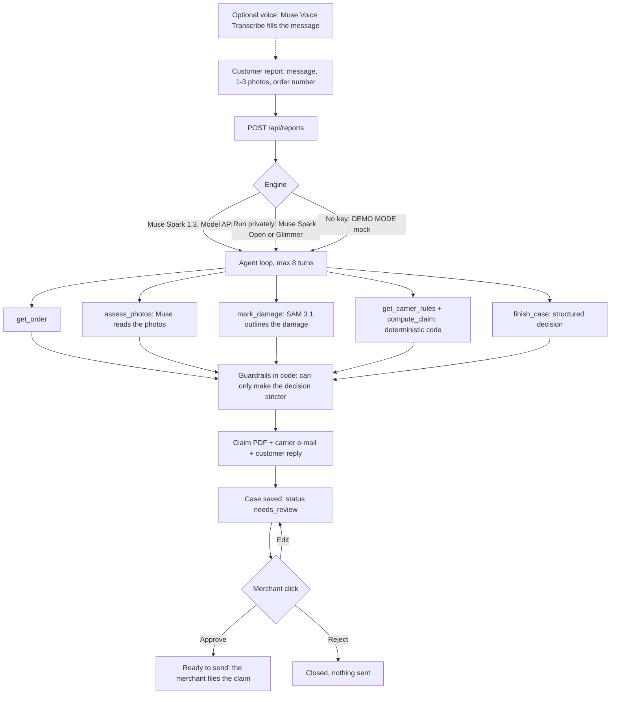

# Damage Desk

**The agent that prepares the claim to recover the money from damaged parcels.**

A customer writes "my vase arrived broken" and attaches a photo. Damage Desk finds the order,
reads the photo, decides what to do (reship, refund, ask for a better photo, or nothing), builds
the carrier claim as a PDF plus a ready-to-send e-mail, and drafts the reply in the customer's
language. The merchant reviews the case and clicks **Approve**, **Edit** or **Reject**.

Nothing is sent without a click, and this app sends nothing at all: the claim and the reply are
drafts that the merchant files or sends.

Built for the Meta Global AI Developer Hackathon, Startups track, theme "Build for Your World".

> **Built during the Meta Global AI Developer Hackathon (Oct 26 – Nov 4, 2026). Prior work: none —
> all code written during the hackathon; domain knowledge from running an e-commerce store's
> customer support.**
>
> All orders, customers and e-mail addresses in this repository are fictitious.

## What was built during the hackathon

Everything: this is a new repository, and the commit history starts on 27 Oct 2026. In order:

- **The agent**: a tool-calling loop on Muse Spark 1.3 (7 tools, at most 8 turns), a structured
  decision, and guardrails in code that can only make it stricter.
- **Deterministic carrier rules and claim maths** from dated, sourced public terms, so the model
  never writes an amount or a deadline.
- **Evidence**: SAM 3.1 outlines the damage and the annotated photo goes into the claim.
- **The dossier**: a claim PDF and an e-mail to the carrier in English, and a reply in the
  customer's language. Nothing is sent: the merchant clicks Approve, Edit or Reject.
- **Voice reports**: the customer can dictate the report (Muse Voice Transcribe).
- **A "Run privately" engine** on open weights (Muse Spark Open on Baseten, or Muse Glimmer on
  Modal), and a clearly labelled OpenRouter test engine.
- **Six recorded real runs** (Muse Spark 1.3 + SAM 3.1) committed as a read-only showcase, and a
  shared-storage backend (Vercel Blob) for a public deployment.
- **Six demo photos generated with Muse Image**, declared as AI-generated.

### How it was built

Built solo by Pablo Priefert during the hackathon, with AI coding agents (Claude Code) doing much
of the implementation under his direction. Every claim about a live run in this README comes from
a real run that was checked, not from the code alone. The early commits are squashed into a few
large ones, so the history is coarser than the work was.

What has been run live, and what has not (details in [Limitations](#limitations)):

| Live on the real service | Written and tested, not run live yet |
|---|---|
| Muse Spark 1.3 and SAM 3.1: all six demo cases end to end, 27 Oct 2026 | Muse Spark Open on Baseten and Muse Glimmer on Modal ("Run privately") |
| Muse Voice Transcribe: real API calls (not yet with a browser microphone) | Vercel Blob storage (tested against a fake SDK only) |
| Muse Image: the six demo photos | Public deployment: not deployed yet |
| OpenRouter test engine: one real photo call | |

753 tests, `tsc` and `eslint` pass, and `next build` passes.

## The problem

When a parcel arrives broken, a small merchant does two jobs by hand: make the customer whole
(a replacement or a refund), then chase the carrier for compensation. The second job is where the
money leaks, because each carrier has its own channel, its own proof, its own cap and, above all,
its own **deadline**, and some of them are short:

| Carrier (standard professional terms) | Compensation | Deadline to claim | Status of the figures |
|---|---|---|---|
| **Colissimo** | 23 EUR/kg, capped at 690 EUR per parcel (33 EUR/kg, 990 EUR with signature) | 12 months (France) | **Dated source**: 2020-12-08 edition of the [general terms](https://www.colissimo.entreprise.laposte.fr/sites/default/files/2021-03/cgv-contrat-facilite.pdf). The 2026 terms are not public, so the current figures are not confirmed. |
| **Colissimo** (3-day reserve window) | n/a | 72 h applied out of prudence | **Unverified**: Commercial Code [art. L133-3](https://www.legifrance.gouv.fr/codes/article_lc/LEGIARTI000021486442) was read, but we found no text saying it applies to Colissimo. It only adds a warning, it never blocks a claim. |
| **Mondial Relay** (Offre Start) | 25 EUR per parcel, shipping not refunded | 72 h after delivery, and the parcel must be **refused** at delivery | **Verified** against the [terms of 2025-09-01](https://www.mondialrelay.fr/media/125872/20250901-france-offre-start-conditions-g%C3%A9n%C3%A9rales-de-vente-fr.pdf) and the [recipient FAQ](https://www.mondialrelay.fr/faq/recevoir-un-colis/mon-colis-est-abime-que-faire/). Lockers are not modelled. |
| **Chronopost** (professional terms) | 250 EUR per parcel by default; 23 EUR/kg capped at 690 EUR for Chrono 18, Chrono Classic, Chrono Relais Europe and mobile-phone items | 3 days after delivery | **Verified** against the [online terms](https://www.chronopost.fr/fr/conditions-generales-de-vente-professionnels), which show no edition date. The "mobile phone" rule is a keyword heuristic of ours. |

Every figure above, with its source URL, check date and status, lives in
[`data/carriers.json`](data/carriers.json) and is shown in the app next to the claim.

Caveats that matter:

- These are the **public standard terms**. A merchant with a negotiated contract may have other
  caps and deadlines, which are not public: treat the figures as unverified for those merchants.
- The merchant usually owes the customer first. As we read French consumer law (Code de la
  consommation art. L216-2, not legal advice), the risk stays with the seller until the consumer
  physically takes the goods. So the agent serves the customer, then claims the carrier. A late
  claim does not change what the customer is owed.
- We found no public claim API at any of the three carriers (a search, not a proof). Claims are
  filed by a human through each carrier's tool or by e-mail, which is why the output is a
  complete dossier that the merchant files.

## How it works

1. **Report.** A customer message (typed or dictated), one to three photos and an order number
   arrive (in the demo, a form that stands in for the inbox).
2. **Investigation.** An agent calls tools in a loop: it fetches the order, reads the photos,
   outlines the damage, looks up the carrier's rules and computes the claim.
3. **Decision.** A structured answer: `reship | refund | ask_more_photos | no_action`, whether to
   claim the carrier, a confidence, reasons, and whether a human must look.
4. **Drafts.** A claim PDF, an e-mail to the carrier's claims department, and a reply to the customer.
5. **Review.** The merchant opens the case, reads the agent's reasoning trace, and approves, edits
   or rejects. The header counter shows the recoverable amount and the claims due this week.



**Amounts and deadlines never come from the model.** They come from the dated, sourced carrier
rules and from deterministic code in `src/lib/rules`. The model can only choose which tool to call
and what to conclude from what the tools return.

**Guardrails run in code after the model answers and can only make a decision stricter.** A human
is required when the confidence is below 0.7, the order is above 300 EUR, the order match is
doubtful, there are fraud signals, the photos are too blurry, a tool failed, the customer reply
quotes a figure the tools did not return, or Muse read the packaging as inadequate on a claim that
is kept (the claim is not cancelled on that reading: it stays, with a merchant-only warning to check
the packing before filing, and the carrier file says nothing about it). Customer text is treated as untrusted data; a
prompt-injection attempt counts as a fraud signal.

## Which Meta models, and why

Four Meta models used live, each with its own job, plus an open-weights route (Muse Spark Open or Muse Glimmer) that is written and tested but not run live yet:

| Step | Model | Why this one |
|---|---|---|
| Investigation | **Muse Spark 1.3** (Meta Model API, Standard mode, `muse-spark-1.3`) | One model does three jobs in the same loop: **vision** (it reads the photos), **tool calling** (order lookup, damage marking, rules, claim maths) and a **structured decision** returned through the `finish_case` tool call and validated in code. |
| Evidence | **SAM 3.1** (Meta Model API) | A claim needs proof, not only a verdict. Muse names the damaged object to outline (for example "broken pottery" or "glass carafe": SAM segments things, not states, so "crack" or "shattered vase" match nothing), SAM segments it, and the annotated photo goes into the claim PDF. If SAM finds nothing or fails, the claim ships with the raw photo and says so. |
| Voice report | **Muse Voice Transcribe 1.0** (Meta Model API, `muse-voice-transcribe-1.0`) | A customer with a broken parcel in their hands talks faster than they type. They dictate the report, the transcript fills the message box (still editable), and the case records that it was dictated, by which model, for how long, and whether it was edited. Audio is processed in memory and never stored. |
| "Run privately" | **Muse Spark Open** (open weights, 816B total / 42B active, natively multimodal, per Meta's model card, not verified here) on **Baseten Model APIs**, or **Muse Glimmer** (open weights, Apache 2.0) on **Modal** (see [`deploy/`](deploy/README.md)) | The same agent, tools and output schema on open weights, so a merchant who does not want customer photos on Meta's API has a route. A private run never calls the Meta Model API: SAM and voice are off too. "Private" means no Meta Model API and no Meta training traffic, **not** "on your hardware": on Baseten the photos and the message go to Baseten, which states that it stores neither inputs nor outputs of synchronous Model API requests. |
| Demo data | **Muse Image** (`muse-image-1.0`, Meta Model API) | The six demo photos are generated, not taken: no real customer, label or address can leak into a public repository. [`scripts/generate-demo-photo.mjs`](scripts/generate-demo-photo.mjs) remakes one. |

The product is the decision and the dossier, not an image analyzer: the photo is one input among
several, and the output is money-shaped (a decision, a maximum compensation, a deadline, a
filled-in claim).

Standard mode only: a model id containing `contributor` (Meta trains on that traffic) is refused in
code (`assertStandardModel`), and a test scans the repository for such ids.

### Voice reports

The browser records the clip and converts it to a 16 kHz mono WAV (the endpoint only takes WAV),
`POST /api/transcribe` sends it to Muse Voice Transcribe (`POST {MODEL_BASE_URL}/asr/transcribe`,
multipart), and the transcript lands in the message box. Details that matter:

- A clip is capped at 90 s, and several clips can be added to one message.
- The real transcription returns a signed receipt (HMAC derived from `MODEL_API_KEY`, valid 30
  minutes). The case says "Voice message, transcribed by muse-voice-transcribe-1.0" only when every
  clip has a valid receipt. Without a key the endpoint returns a labelled canned transcript and the
  case says "DEMO MODE, canned transcript": it is never attributed to Muse. On a public deployment
  the endpoint needs the access code, like a report does.
- Spoken digits can come back as words ("Order one thousand one"), so the agent is told that a
  verified dictation may contain misheard names and numbers.
- Voice is off in "Run privately" mode (the audio would go to Meta), and a dictated message cannot
  be filed as a private run.
- Recording needs HTTPS or localhost and a browser with `MediaRecorder`; otherwise the form says so
  and the customer types.

### Open weights

"Run privately" picks the engine by configuration. The case, the trace, the badge, the case list
and the claim PDF footer name the model and the host that actually ran ("Muse Spark Open (open
weights, served by Baseten)", "Muse Glimmer (open weights, served by Modal)"), never a hostname.
If the model cannot read the photos (`OPEN_WEIGHTS_VISION=0`, or the server refuses them), the agent
does not pretend: the trace says "The photos were NOT read by the model", the damage reading and
the claim are refused, the carrier claim is dropped, and a human takes the case. When Muse Spark
Open is the configured model, the footer shows "Built with Muse Spark Open." (Muse Model License).

### OpenRouter test engine

Optional, and only listed on the report screen when `OPENROUTER_API_KEY` is set: `meta/muse-spark-1.3`
through OpenRouter, for cheap bulk runs. It is labelled "test engine, not private", is never the
default, sends the photos to OpenRouter and to the model's provider, and does not call SAM.

## Architecture

A single Next.js (TypeScript) app, no database: cases are JSON files (or objects in a private
Vercel Blob store on a public deployment), claim PDFs are built with `pdf-lib`.

- `src/lib/agent/`: the loop (`run-agent.ts`, at most 8 model turns), the tool schemas
  (`tools.ts`, 7 tools), the system prompt, and the guardrails (`guardrails.ts`).
- `src/lib/providers/`: an OpenAI-compatible client for Muse Spark 1.3, for open weights (Baseten,
  Modal, custom endpoint) and for the OpenRouter test engine, plus the deterministic demo mock.
- `src/lib/rules/` and `data/carriers.json`: carrier rules and the claim maths (maximum
  compensation, deadline, warnings).
- `src/lib/evidence/`: the SAM 3.1 call and the annotation of the photo.
- `src/lib/voice/` and `src/app/api/transcribe/`: the Muse Voice Transcribe client, WAV header
  validation, limits and the signed receipt.
- `src/lib/documents/`: the claim PDF and the e-mail to the carrier.
- `src/lib/orders/`: fictitious orders (`data/fixtures/orders.json`) and an optional read-only
  Shopify connection (`read_orders` only).
- `src/lib/store/`, `src/lib/storage/`: case files, the header counter, the demo cases; an
  `ObjectStore` seam with a local-file backend (default) and a Vercel Blob backend
  ([`docs/storage.md`](docs/storage.md)).
- `src/lib/showcase/` and `data/showcase/`: the six recorded real runs, read-only.
- `src/app/`, `src/components/`: the UI (Cases list, new report with voice recorder, case review)
  and the API routes.
- `deploy/`: Muse Spark Open on Baseten and Muse Glimmer on Modal ([`deploy/README.md`](deploy/README.md)).

## Run it locally

```bash
npm install
cp .env.example .env.local    # optional; leave MODEL_API_KEY empty for demo mode
npm run demo                  # the six demo cases end to end: no key, no network
npm run dev:demo              # the web app in demo mode, never spends credits
npm run real -- <case-id>     # one demo case on the real Muse Spark 1.3 + SAM 3.1 (paid, needs a key)
```

Environment variables (all listed, empty, in [`.env.example`](.env.example)):

| Variable | Purpose |
|---|---|
| `MODEL_API_KEY` | Meta Model API key (Muse Spark, SAM, Muse Voice Transcribe). Empty means **demo mode**. |
| `MODEL_BASE_URL` | Defaults to `https://api.meta.ai/v1`. |
| `MODEL_REASONING_EFFORT` | Optional reasoning effort for Muse Spark. |
| `OPEN_WEIGHTS_PROVIDER` (`baseten` or empty), `BASETEN_API_KEY`, `BASETEN_MODEL` | "Run privately" on Muse Spark Open through Baseten Model APIs. |
| `OPEN_WEIGHTS_BASE_URL`, `OPEN_WEIGHTS_MODEL`, `OPEN_WEIGHTS_API_KEY`, `OPEN_WEIGHTS_PROXY_KEY`, `OPEN_WEIGHTS_PROXY_SECRET` | "Run privately" on any other OpenAI-compatible server (Muse Glimmer on Modal, or Muse Spark Open elsewhere). |
| `OPEN_WEIGHTS_REASONING_STRENGTH`, `OPEN_WEIGHTS_VISION` | Reasoning depth (the `reasoning_effort` field on Baseten, a system-prompt line on Glimmer); `0` declares a model that cannot read images. |
| `OPENROUTER_API_KEY`, `OPENROUTER_MODEL` | Optional OpenRouter test engine (default `meta/muse-spark-1.3`). |
| `SAM_BASE_URL` | SAM 3.1 endpoint if different from `MODEL_BASE_URL`. |
| `SHOPIFY_SHOP_DOMAIN`, `SHOPIFY_ADMIN_ACCESS_TOKEN` | Optional read-only dev store. Empty means fictitious orders. |
| `MERCHANT_NAME`, `MERCHANT_ADDRESS`, `MERCHANT_EMAIL` | Merchant identity printed on the claim. |
| `DAMAGE_DESK_ACCESS_CODE`, `DAMAGE_DESK_REAL_RUNS_PER_DAY` | For a public deployment: a shared code that every new report (demo mode included), every dictation and every approve/edit/reject needs (401 without it, 429 after 10 wrong codes in 10 minutes from one client, counted on `x-forwarded-for`, which is reliable on Vercel only; use a random code of 16+ characters), and a daily cap of real runs (default 100, counted per instance in memory). |
| `DAMAGE_DESK_STORAGE` (empty, `file` or `blob`), `BLOB_READ_WRITE_TOKEN` | Case storage: local files (default) or a private Vercel Blob store ([`docs/storage.md`](docs/storage.md)). On Vercel the Blob SDK authenticates with `BLOB_STORE_ID` and the injected OIDC token; `BLOB_READ_WRITE_TOKEN` is only for code running outside Vercel. |

**Demo mode.** Without `MODEL_API_KEY` the app uses a deterministic mock provider and labels every
result "DEMO MODE": the case, the trace, the badge, the PDF footer and the logs. The mock follows a
script keyed on the customer's words and on what the tools return, and never looks at an image.
A mock answer is never presented as coming from Muse.

**Real mode.** Set `MODEL_API_KEY`. Careful: Next.js loads `.env.local`, so a key there makes a
plain `npm run dev` call the real, paid models and send the photos to Meta. `npm run dev:demo`
(and `npm run start:demo`) empty `MODEL_API_KEY`, the open-weights variables, `BASETEN_API_KEY` and
`OPENROUTER_API_KEY` for that process.

**Open weights.** Quickest path: set `OPEN_WEIGHTS_PROVIDER=baseten` and `BASETEN_API_KEY`, check it
with `npm run probe -- open-weights --models --chat`, then run
`npm run real -- demo-1-vase-broken open-weights` or pick "Run privately" on the new-report screen.
Muse Glimmer on Modal: follow [`deploy/README.md`](deploy/README.md).

Checks: `npx vitest run`, `npx tsc --noEmit`, `npm run lint`. Tests use no network and no key, and
write to a throwaway folder, never to `data/runtime/`.

## The six demo cases

`npm run demo` runs them through the agent in demo mode and stores them so the Cases screen shows
them. On the new-report screen each one is a single click. The "Expected" column is what the
scripted demo mode produces, and what `data/demo-cases.json` checks; it is not a measured result of
Muse.

| # | Story | Expected |
|---|---|---|
| 1 | Broken vase, Colissimo, order #1001 | Reship, claim the carrier. Maximum 52.90 EUR (23 EUR/kg x 2.3 kg, under the 58 EUR item value). |
| 2 | Crushed carton, product intact, #1002 | No action, no claim: nothing to compensate. |
| 3 | Blurry lamp photo, #1003 | Ask for sharper photos before deciding anything. |
| 4 | Parcel opened at the relay, saucers missing, Mondial Relay, #1004, customer writes in French | Reship, claim within the 72 h window (25 EUR maximum), reply in French. |
| 5 | Cracked headphones, 349 EUR, #1005 | Everything prepared (250 EUR maximum under the Chronopost default), but handed to a human because the value is above 300 EUR. |
| 6 | Cracked carafe reported nine days after delivery, #1006 | Refund the customer; no carrier claim, the 3-day window has passed. |

### Measured on the real models (27 Oct 2026)

All six cases were also run end to end on the real **Muse Spark 1.3** and **SAM 3.1** (Meta Model
API, Standard mode) with `npm run real -- <case-id>`. Each gave the expected decision:

| # | Decision (Muse Spark 1.3) | Claim | SAM 3.1 evidence (concept named by Muse) | Time |
|---|---|---|---|---|
| 1 | reship, claim the carrier, confidence 0.95 | 52.90 EUR | 5 shards outlined ("broken pottery") | 36 s |
| 2 | no action, no claim | none | 1 region ("torn cardboard") | 25 s |
| 3 | ask for more photos, handed to a human (confidence 0.35) | none | none: the photo is too blurry to outline | 16 s |
| 4 | reship, claim the carrier, reply in French | 25.00 EUR | 5 regions ("torn cardboard") | 22 s |
| 5 | reship, claim the carrier, handed to a human (value above 300 EUR) | 250.00 EUR | 2 ear cups ("ear cup") | 27 s |
| 6 | refund, no claim (3-day window passed) | none | 1 region ("glass carafe") | 18 s |

SAM 3.1 segments **things, not states**: on these photos "crack", "dent" or "shattered vase"
matched nothing, while "broken pottery", "glass carafe" or "ear cup" did
(`npm run sam-probe -- <photo> "<concept>" ...`). The prompt asks Muse for the damaged object, and
the code falls back to the item of the assessment, then to the parcel itself.

> **About the demo photos.** The images in `data/photos/` were **generated with Meta's Muse Image**
> (`muse-image-1.0`) for this project; they are not photographs taken by the team, and show
> fictitious parcels only (see [`data/photos/README.md`](data/photos/README.md)). Dropping
> `<name>.jpg` next to one replaces it with a real photo.

### Recorded runs (the showcase)

[`data/showcase/`](data/showcase/README.md) holds those six real runs, with their photos, the
SAM-annotated evidence and the claim PDFs, committed as they came out of `npm run real` (nothing
edited, nothing re-run to look better). The app lists them next to the cases you file, marked
**Recorded run**, so a fresh clone or deployment is never an empty inbox and a judge sees real
model output, not the scripted mode. They are read-only: Approve, Edit or Reject on one stores a
copy and the recording never changes. Their deadlines are shown as of the recording and they are
left out of the "recoverable this month" counter, which therefore reads 0 on a fresh deployment; a
second line, "Recorded runs: EUR 327.90 recoverable (as of 27 Oct 2026)", shows what they found,
computed from the recordings. Everything in them is fictitious, and a test
(`src/lib/showcase/audit.ts`) refuses anything else.

## Deploy to Vercel

**Not deployed yet.** The checklist, in this order:

1. Upgrade `next` and `eslint-config-next` together to 16.4.1 or later (allowed by the project's
   14-day dependency rule from 28 Oct 2026 17:44 UTC; `next@16.4.0` has critical advisories), then
   re-run tests and `npm run build`. Do not expose a URL before that.
2. Leave Fluid Compute on (the default): `POST /api/reports` declares `maxDuration = 120` itself.
3. Environment variables (Production): `MODEL_API_KEY` (Standard model only),
   `DAMAGE_DESK_ACCESS_CODE` (give it to the judges), `DAMAGE_DESK_REAL_RUNS_PER_DAY`; optionally
   `MERCHANT_*` and the open-weights variables. **Never set `SHOPIFY_*` or `OPENROUTER_API_KEY` on
   the public deployment**: the first would put a store's orders on a public URL, the second would
   open the third-party test engine to every visitor. Set a **spend alert on the Meta console**: the
   daily cap of real runs is per instance and in memory, so it is a soft limit.
4. Storage: **a public deployment that accepts reports needs Vercel Blob.** The default is temporary
   and per serverless instance: a case a visitor files can answer "not on this server" from another
   instance, and a claim PDF that is not found on the instance that serves the request is rebuilt on
   the spot, which needs the access code that the iframe of the case page cannot send (the preview
   fails with a 401). Only a deployment that shows the recorded runs and takes no report can keep the
   default. For Vercel Blob ([`docs/storage.md`](docs/storage.md)): create the store
   **private** (it cannot be changed afterwards) with the CLI, from the linked project,
   `vercel blob create-store damage-desk --access private --yes`, which adds `BLOB_STORE_ID` and an
   OIDC token to the project, then set `DAMAGE_DESK_STORAGE=blob`. `BLOB_READ_WRITE_TOKEN` is only
   needed for code running outside Vercel. The Blob backend has only been tested against a fake SDK.
5. Deploy, open `/`: the six recorded runs must be listed with photos, outlined evidence and PDF.
   File one report with the access code to check the whole flow, and from a second browser open its
   case. Also check that a report without the code is refused (401).

Do **not** put real customer data on the public URL: the case list, every case page, the photos
and the claim PDFs are open to anyone with the link. New reports (demo mode included), voice
transcription and approve/edit/reject need the access code, so a stranger cannot put anything on
the page the judges look at; the six recorded runs stay visible to everyone. The code is a shared
secret in the submission: make it random and at least 16 characters (`openssl rand -base64 18`).
Nothing caps the number of cases stored by people who hold the code (each report is limited to 30
per 10 minutes per client), so after a public round purge the store by hand (Vercel dashboard,
Storage, the Blob store).

## Limitations

- **Verified live on Muse Spark 1.3, SAM 3.1 and the voice API; not on open weights.** The six demo
  cases ran end to end on the Meta Model API on 27 Oct 2026 (table above), and Muse Voice
  Transcribe answered real calls ("My vase arrived broken. Order 1001." in about 2 s). Six cases
  are a smoke test, not an accuracy benchmark.
- **Voice has not been tried with a real microphone in a real browser.** The recorder and the WAV
  conversion are tested with a fake `MediaRecorder` only. Accents and background noise were not tested,
  and digits may come back as words.
- **Open weights are not run live yet.** Muse Spark Open on Baseten and Muse Glimmer on Modal are
  written and tested against fakes; no Baseten credits were available and nothing has called
  Baseten or Modal. The Baseten slug differs between the hackathon guide
  (`meta-models/muse-spark-open-1026`, the default here) and Baseten's docs
  (`meta-models/muse-spark-open`): `npm run probe -- open-weights --models` settles it. Whether the
  model reads the photos and how long a run takes (`reasoning_effort` defaults to `medium` to stay
  inside a run's time budget) are untested. The Modal deploy script has only been syntax-checked.
  "Verified by the partner" for the open-weights prize is not something this repository can
  provide on its own.
- **The OpenRouter engine** was called once with a real photo (27 Oct 2026). It is a test engine,
  not private.
- **Demo mode is scripted.** It shows the product flow, not the quality of Muse's reading of a photo.
- **The demo photos are AI-generated** (Muse Image), not photographs of damaged parcels. A real
  photo may read differently.
- **Carrier figures are the public standard terms**, some from a dated source and one window
  unverified (table above). Not modelled: insurance (ad valorem), negotiated contracts, relay
  lockers, public holidays, the carrier-measured weight.
- Colissimo pays on the purchase value of the content; the order only carries the sale price, so the
  computed maximum may be higher than the real indemnity.
- **Nothing is filed.** The app files no claim and sends no e-mail; a human does.
- **Not legal advice.** The rules are our reading of public terms and statutes.
- **Public deployment is not done.** The app has not been deployed. `next@16.4.0` has critical
  security advisories and must be upgraded to 16.4.1 (allowed from 28 Oct 2026 17:44 UTC), and
  `undici` 6.29.1 is due from 29 Oct, before any public URL. Vercel Blob storage has not run
  against a real store. Without it, cases filed by visitors are temporary and per instance; rate
  limits and the daily cap of real runs are in memory, per instance. The merchant actions are
  serialised inside one instance; across instances they rely on conditional writes, which the Blob
  backend uses but has not been exercised on.

## Third-party licences

This repository's own code is MIT-licensed (see [`LICENSE`](LICENSE)). It depends on packages under
their own licences:

- **`@meta-sam/parser`**, which decodes SAM 3.1 masks, is **not MIT**: it is under Meta's SAM
  License (`node_modules/@meta-sam/parser/LICENSE`). It is installed as a dependency, not
  redistributed or modified here.
- Muse Glimmer (`meta-models/Muse-Glimmer-30B`) is Apache 2.0.
- Muse Spark Open is under the **Muse Model License**. The app footer shows "Built with Muse Spark
  Open." whenever it is the configured model (see [`deploy/README.md`](deploy/README.md)).
- `next`, `react` and `pdf-lib` are MIT; `openai`, `sharp` and `@vercel/blob` are Apache 2.0. Run
  `npm ls` for the full tree.

## License

MIT. Copyright (c) 2026 Pablo Priefert.
